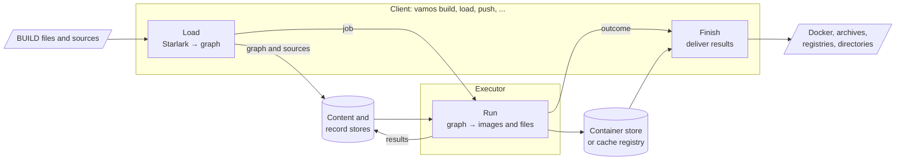

# vamos design

This directory contains the design documentation for vamos, written for contributors and maintainers.
It explains how the system is structured, the boundaries between its components,
and the engineering decisions behind its implementation, including rejected alternatives.
Users looking for command-line usage and BUILD language syntax should read the [user guide](../user/README.md) instead.

## Reading order

The design documents build progressively on one another:

1. [Architecture](architecture.md): Start here.
   Introduces the three execution phases (load, run, finish), the client and executor components,
   and the progression of target identity across phases.
2. [Client/executor protocol](execution-protocol.md):
   Details the API boundary between clients and executors, job submission lifecycles,
   event streams, and specialized push, publication, and export jobs.
3. [Package layering](package-layering.md):
   Documents the internal Go package dependency hierarchy, architectural boundary rules,
   and the pipeline for extending the build language.
4. [Scheduling and concurrency](scheduling.md):
   Explains how the scheduler traverses target dependency graphs, deduplicates in-flight execution attempts,
   streams events to clients, and coordinates concurrency locks.
5. [Storage and identity](storage.md):
   Details the three storage layers, artifact identity calculations, action keys,
   lockfile pin resolution, and cache eviction.
6. [Container builds and delivery](container-builds.md):
   Covers target execution lifecycles, execution platform selection, foreign architecture emulation,
   and delivering build artifacts to registries, Docker daemons, or filesystem directories.
7. [Remote execution](remote-execution.md):
   Describes distributed builds across coordinator and worker pools, HTTP transport,
   attempt leasing and worker fencing, and Kubernetes deployment.
8. [Releases](releases.md):
   Documents the multi-platform build pipeline, packaging invariants, glibc portability requirements,
   and the installer script.

## At a glance

vamos evaluates Starlark `BUILD` files on the client to produce a dependency graph,
executes that graph using the buildah library on an executor,
and delivers final outputs to requested destinations.
The executor runs either locally within the client process or remotely as a coordinator distributing actions to workers.

The following diagram shows the high-level flow of data between client phases, the executor, cache storage,
and delivery destinations.

## Documentation ownership

vamos documentation follows strict ownership boundaries:

- Go symbol contracts are documented in doc comments directly above declarations.
- Package-level invariants, lifecycles, and navigation are documented in each package's `doc.go`.
- Cross-package interactions, data models, and architectural decisions are documented here in `docs/design/`.
- Contributor workflows, testing instructions, and validation steps are indexed in [AGENTS.md](../../AGENTS.md).
