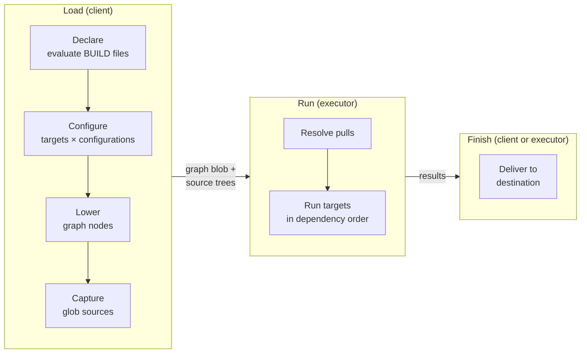
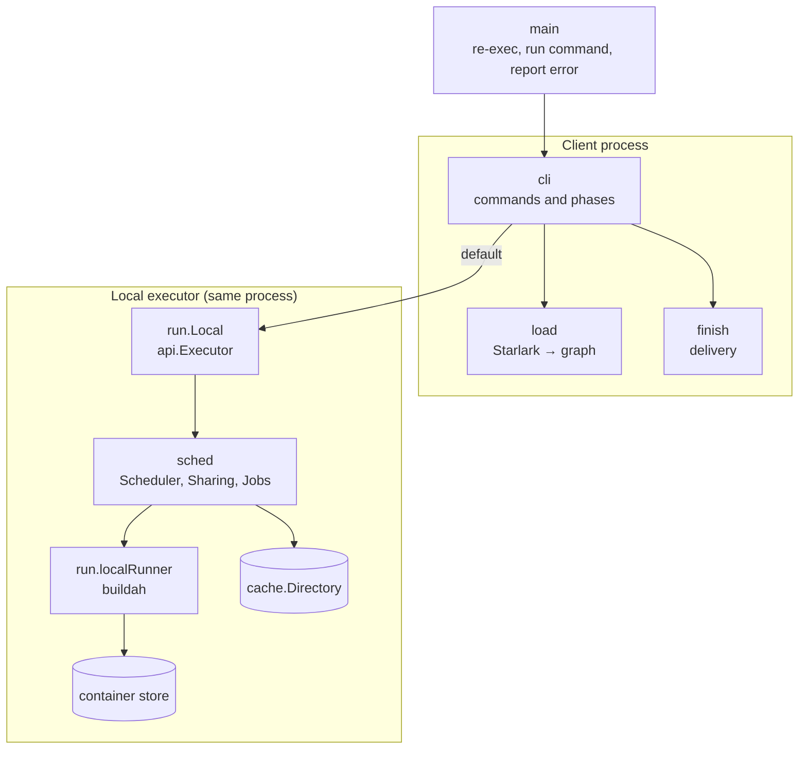
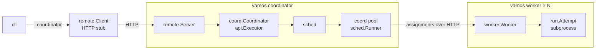

# Architecture

This document describes the high-level architecture of vamos: the three execution phases,
the client and executor components, and how build targets transition through the pipeline.

vamos evaluates Starlark `BUILD` projects and builds OCI container images using the buildah library directly.
It does not generate Dockerfiles or invoke Docker or buildah command-line executables to build targets:
Docker is a destination for built images, not the build engine.

## Phases

Every command runs across three distinct phases, which [cli](../../internal/cli/doc.go) coordinates:

| Phase  | Placement          | Owner                                  | Boundary                                               |
| ------ | ------------------ | -------------------------------------- | ------------------------------------------------------ |
| Load   | Client             | [load](../../internal/load/doc.go)     | Project files and Starlark evaluate into a graph and cached sources |
| Run    | Executor           | [run](../../internal/run/doc.go)       | Cached graph and sources execute into images or task files |
| Finish | Client or executor | [finish](../../internal/finish/doc.go) | Completed artifacts reach requested destinations       |

The following diagram shows how a build progresses through the three phases and what data crosses between them.

The graph structure and the content store form the boundary between load and run.
No Starlark values, open file descriptors, or in-memory loader data structures cross this boundary.
Because the executor operates entirely on self-contained graphs and content addresses,
it never needs access to the source project workspace and can execute on another machine.

The executor manages the buildah runtime, local container storage, and base image pulls.
Pushes and publications normally execute on the executor as well, using credentials configured in its environment.
When passed `--push-from=client`, pushes execute during the finish phase instead,
using the client's credentials and local registry settings.
Registry interaction can therefore take place in either the run or finish phase depending on command flags.

## Execution components

In the default configuration, the client executes all phases within its own process.

The following diagram shows the components when the client runs the executor locally within its own process.

When started with `--coordinator`, the client connects to a remote coordinator over HTTP,
which delegates action execution across worker nodes.

The following diagram shows the distributed architecture when the client connects to a remote coordinator over HTTP.

The local executor and the coordinator are interchangeable implementations of the `api.Executor` interface.
Clients interact with both through the same methods and distinguish them only by their reported capabilities.
Both implementations use the same scheduling engine, [sched](../../internal/sched/doc.go),
differing only in their `sched.Runner` backend:
- The local executor uses a runner that calls buildah routines in-process.
- The coordinator uses a pool runner that assigns actions to workers over HTTP,
  where each worker executes actions in isolated subprocesses using the same buildah runner.

Details of the coordinator and worker communication protocol appear in [Remote execution](remote-execution.md).
The API contract and execution sequence are detailed in [Client/executor protocol](execution-protocol.md).

## Target identity across phases

vamos distinguishes between two notions of package:
- A BUILD package is a directory in a source workspace containing a `BUILD` file, addressed as `//dir:name`.
- A Go package is an internal Go module subsystem, such as `internal/sched`.

Before execution begins, a target's identity combines its label and its configuration:
if two targets depend on the same underlying rule under different build configurations,
the loader constructs two distinct nodes in the graph.
Target configuration identity is tracked by `load.confLabel` in [config.go](../../internal/load/config.go),
and the serialized execution model is represented by [graph](../../internal/graph/doc.go).
Once loading completes, targets are identified strictly by content address and action key,
as detailed in [Storage and identity](storage.md#identities).

## Further reading

The remaining design documents explore each subsystem in detail:

- [Client/executor protocol](execution-protocol.md):
  The API contract, job submission lifecycle, event streams, and push/publication/export mechanics.
- [Package layering](package-layering.md):
  Internal Go package dependencies, boundary verification rules, and extending the build language.
- [Scheduling and concurrency](scheduling.md):
  Graph traversal, deduplication of in-flight execution, event streaming, and concurrency locks.
- [Storage and identity](storage.md):
  Three storage layers, artifact identity calculations, action keys, and cache eviction.
- [Container builds and delivery](container-builds.md):
  Target execution lifecycles, execution platform selection, emulation, and artifact delivery.
- [Remote execution](remote-execution.md):
  Distributed execution across coordinators and workers, HTTP protocol, and Kubernetes deployment.
- [Releases](releases.md):
  Multi-platform packaging, glibc portability requirements, and installer script mechanics.
