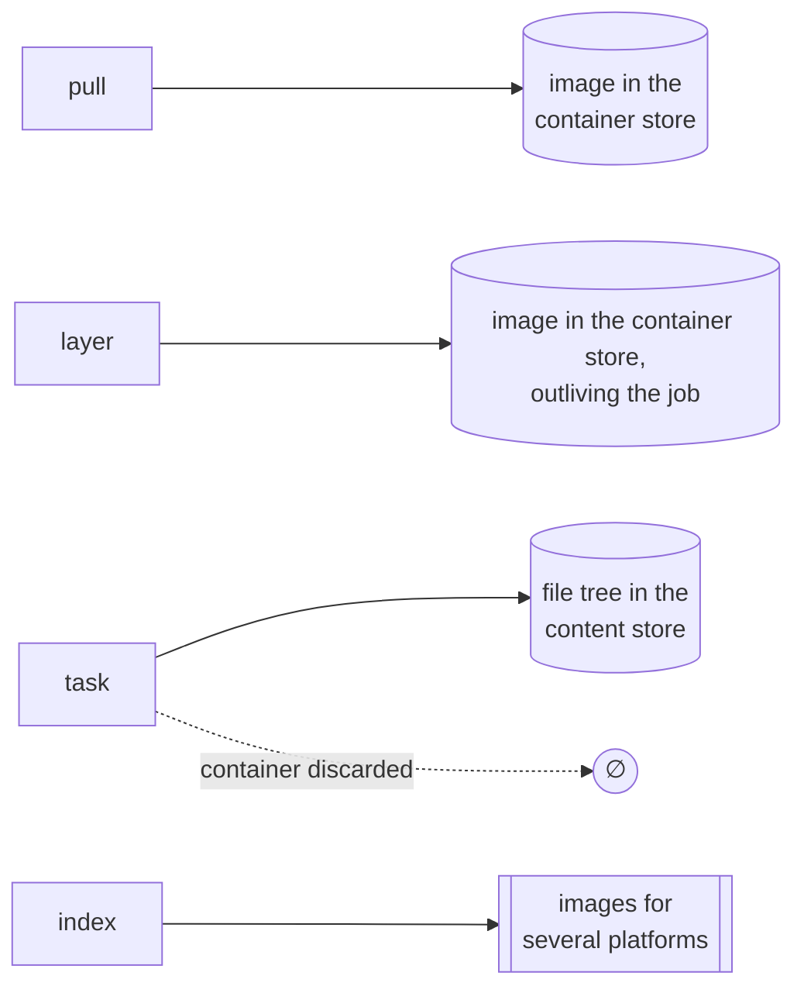
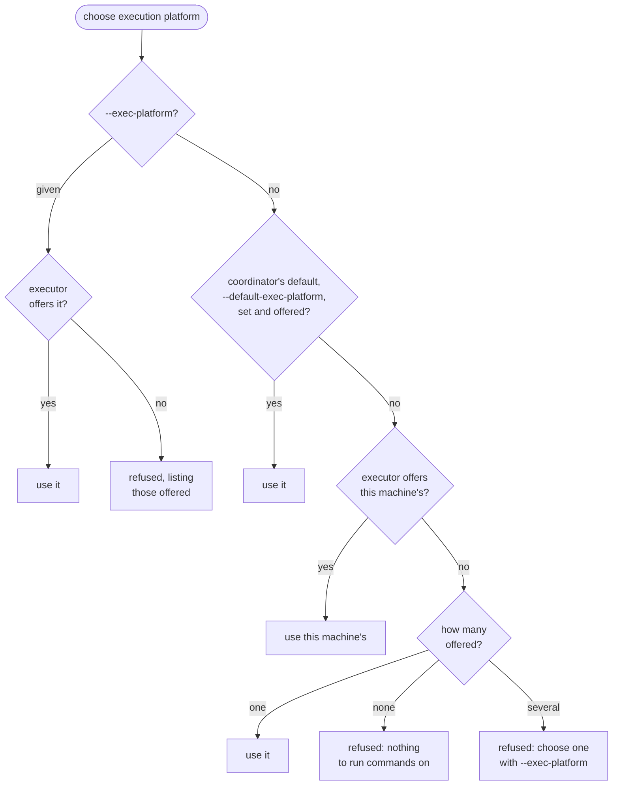
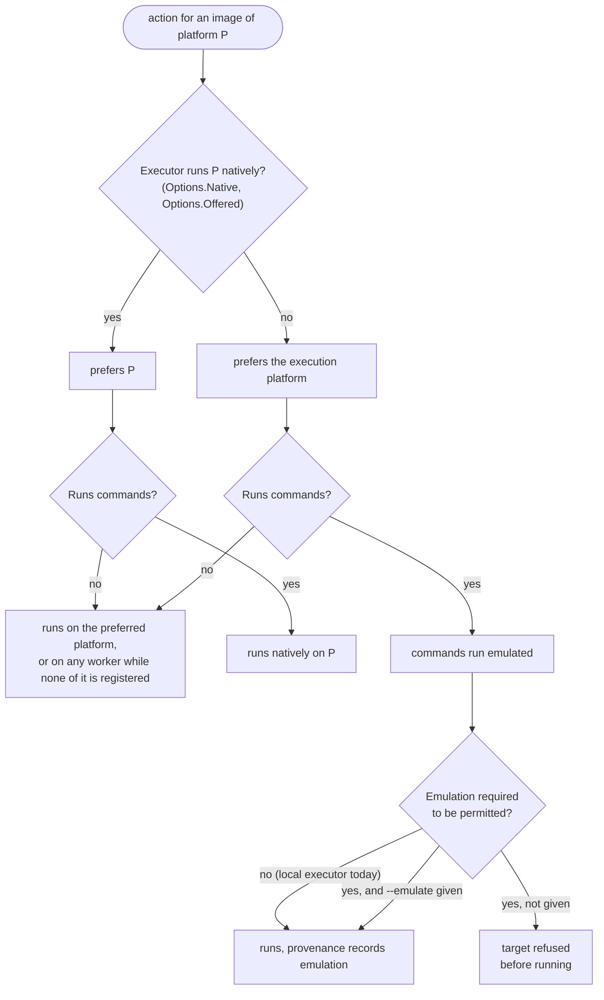
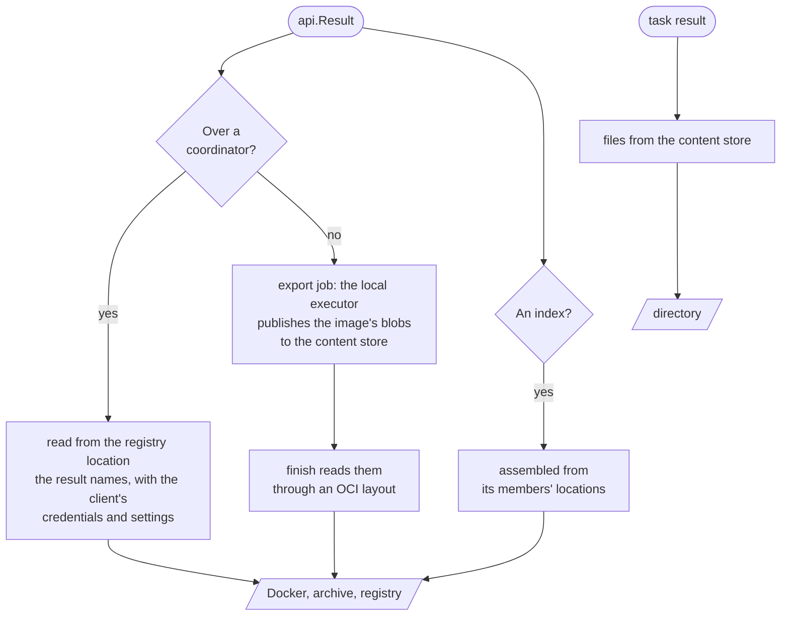
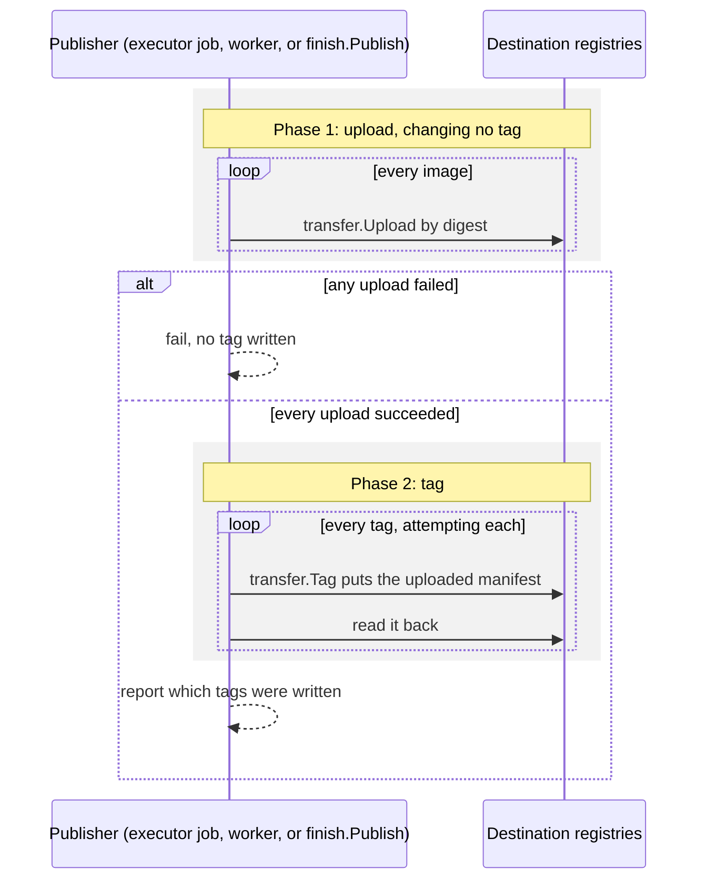
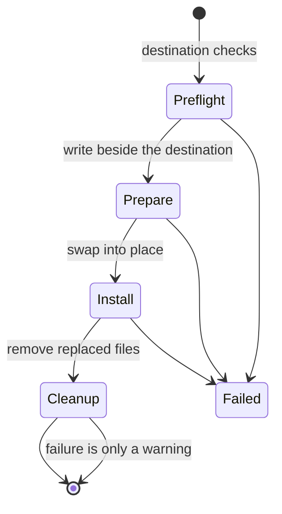

# Container builds and delivery

This document describes target execution and artifact delivery in vamos: the build lifecycle, target result types,
execution platform selection, architecture emulation, and delivery to destinations.
The phase transitions separating load, run, and finish are documented in [Architecture](architecture.md#phases).

## Build lifecycle

Build execution follows a strict sequence:
1. The loader configures every reachable target and captures referenced source trees into the content store.
2. Base image pulls resolve and download necessary image layers.
3. Target actions execute in dependency order.

Evaluation is lazy: packages and targets not transitively needed by requested command targets are never loaded.
The only workspace-wide scan occurs during `vamos update`, which traverses all packages to refresh lockfile pins.

Source file contents used during execution are strictly the immutable blobs captured in the content store.
An `add()` step never reads live workspace files directly from the host filesystem during execution.
If a developer modifies a file while a build is running, the build executes using the snapshot captured at load time,
preserving deterministic cache key association.

## Result kinds and storage lifetimes

Different target types produce distinct outputs with different persistence rules:

The following diagram shows the artifacts and storage lifetimes produced by each target kind.

- A **pull** caches an upstream base image layer in the container store.
- A **layer** builds a container filesystem layer and saves the resulting image in the container store,
  where it persists beyond the lifecycle of the job.
- A **task** runs commands in an ephemeral container, discards the container upon completion,
  and preserves only requested output files as a tree in the content store.
- An **index** aggregates multiple platform-specific images into a multi-platform OCI index.

Execution ownership is defined in [run](../../internal/run/doc.go),
and cache validation is documented in [Storage and identity](storage.md).

## Platforms and emulation

Platform evaluation spans configuration, execution, and delivery phases.
The system maintains a fundamental distinction between the **execution platform** (`EXEC_PLATFORM`),
which identifies the host environment executing build commands,
and the **target platform**, which describes the operating system and architecture of the resulting container image.

### The execution platform

The execution platform is a single global configuration chosen for the entire target graph.
It determines how `EXEC_PLATFORM` rules are configured, directly fixing action keys and cache identity.
The client selects this platform from the options advertised in `api.Capabilities.Platforms` before loading begins.

The following diagram shows how the client selects the execution platform for a build.

Coordinators should configure `--default-exec-platform` so that clients connecting from different host architectures
generate identical action keys for architecture-independent tasks.

### Where an action runs

After graph loading completes, the scheduler chooses the execution platform for each individual action
via `Scheduler.runPlatform`.
This selection is stored as runtime metadata in `sched.Request.RunPlatform` and is excluded from the action key.

The following diagram shows how the scheduler assigns an action to a native or emulated platform.

A coordinator advertises all platforms supported across its registered workers,
dispatching actions to native workers whenever available.
When actions require emulation on a coordinator, `sched.Options.OptIn` enforces that the client granted permission
via `api.GraphRequest.Emulate` (set by the `--emulate` flag).
The local executor does not yet require this opt-in, executing emulated targets locally whenever handlers are available.

### Multi-platform indexes and single-image destinations

Indexes serve as command-line build roots or publication units.
How an index is evaluated depends on the requested CLI operation:
- `build`, `push`, and `publish` commands build and preserve multi-platform indexes.
- `load` and `save` commands select a single platform manifest before evaluating dependencies,
  avoiding building image variants that Docker daemons or single-image archives cannot consume.

Target edge propagation and destination manifest selection are managed by `workspace.edge` and `workspace.imageRoot`
in [load](../../internal/load/doc.go).

### Emulation and binfmt_misc

Cross-compilation and emulated binary execution are distinct mechanisms.
Wherever possible, builds should use native cross-compilation toolchains
(such as the Go compiler configuration in [golang-cli/BUILD](../../examples/golang-cli/BUILD)).
When steps execute foreign binaries directly, execution relies on the Linux kernel's `binfmt_misc` facility.

Kernel `binfmt_misc` handlers belong to the host kernel rather than individual containers:
- Handlers registered with the `F` (fix-binary) flag—including those registered by Docker Desktop
  and the `tonistiigi/binfmt` container—open the emulator binary at registration time.
  They execute foreign binaries in any container without needing `/proc/sys/fs/binfmt_misc` mounted,
  and without requiring emulator binaries to be present inside the container filesystem.
- Handlers registered without the `F` flag look up emulator paths inside the container executing the binary,
  requiring the emulator binary to exist within the container filesystem.

Mounting `/proc/sys/fs/binfmt_misc` inside a container exposes only administrative registration files;
it does not resolve `exec format error` failures.
In remote execution, workers inspect `/proc/sys/fs/binfmt_misc` only to report available emulators
to the coordinator during registration, as described in [Remote execution](remote-execution.md#assignment).

For Docker Desktop's bundled QEMU configuration,
see Docker's [multi-platform emulation guide](https://docs.docker.com/build/building/multi-platform/#qemu).
On macOS systems with Apple silicon, Rosetta provides hardware-assisted x86_64 emulation
through Docker Desktop's virtual machine settings.

## Artifact delivery

Delivery is decoupled from target execution and caching.
When a build completes, successful target outputs remain cached in the store even if subsequent delivery fails;
the system does not roll back executor cache writes on delivery failures.

### Where finish reads an image

The finish phase reads completed outputs strictly from designated result stores;
it never inspects loader data structures, live workspace files, or the executor's internal working directories.

The following diagram shows how the finish phase retrieves images and task outputs from local or remote stores.

Delivery mechanics adapt to the execution environment:
- In local builds, the executor runs an export job publishing image blobs to the content store,
  and delivery streams blobs directly to Docker or local archives without network transport.
- In remote builds, the coordinator does not export blobs to the content store;
  the client finish phase reads images directly from the registry locations reported in the action result.
- Client TLS settings (`--tls-verify`) govern outbound destination connections.
  For intermediate images, `finish` matches repository prefixes against `api.Capabilities.Registries`:
  if the policy marks an intermediate registry insecure, the client sets `DockerInsecureSkipTLSVerify`,
  which disables TLS certificate verification and allows HTTP fallback for reading source artifacts
  while maintaining configured TLS verification for final destinations.

### Publications

Publication delivers images across two coordinated phases,
guaranteeing that destination tags are never modified until all image content is fully uploaded.

The following sequence diagram shows the two-phase publication workflow to destination registries.

The publication phases enforce specific guarantees:
1. **Phase 1: Content upload by digest**:
   Every layer blob and manifest is uploaded to destination registries strictly by content digest.
   Because digest uploads do not move tags, failed uploads leave existing tags unaffected.
   On a coordinator, uploads execute as attempts across worker nodes and are safely retried on network failure.
2. **Phase 2: Tag application**:
   Once all digests exist at the destination, the publisher writes the designated tags.
   Tag application retries transient network errors during registry calls,
   but on a coordinator, the whole tagging attempt is never reassigned to another worker if the worker is lost,
   since remote writes may have already taken effect.
   If interrupted, the publisher reports the tags successfully verified.

### File destinations

Task outputs delivered to local directories follow an atomic staging sequence:

The following state diagram shows the lifecycle of installing task output files into a destination directory.

The installation sequence stages outputs before placing them at the destination path:
- Preflight checks confirm filesystem permissions before extracting outputs.
- Files are staged in a temporary sibling directory beside the destination.
- Installation swaps the staged directory into place using atomic directory exchange (`exchange`).
  Where the underlying filesystem does not support atomic exchange (returning `EINVAL`),
  it falls back to a two-step swap that moves the existing destination aside,
  meaning the destination path is briefly absent before the staged directory moves into place.
- Cleanup removes replaced files; failures during post-install cleanup emit warnings but do not fail the build.

### Host and container path mapping

Path handling rules govern file translations across host filesystems and container chroots
during source capture, checkout, and task output extraction:
`cache.Checkout`, `fileset.Walk`, `targetState.addSource`, and `collectOutput`.
Symlink handling, permission masking, and directory traversal constraints are documented in their respective Go symbol
comments.
