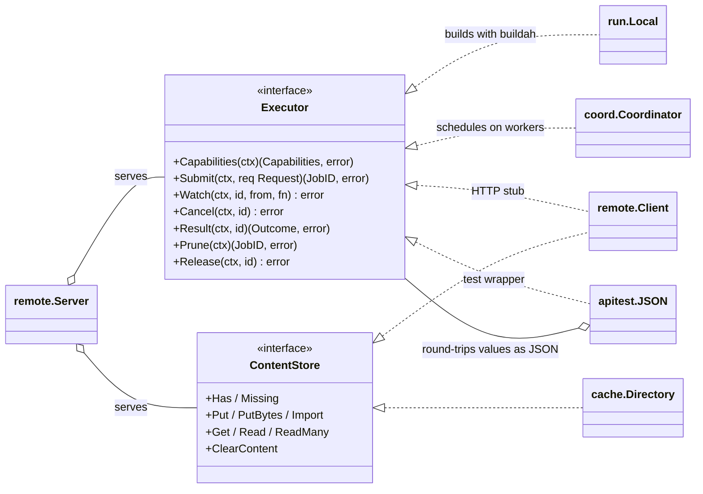
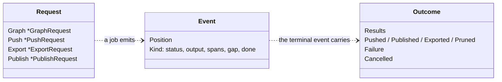
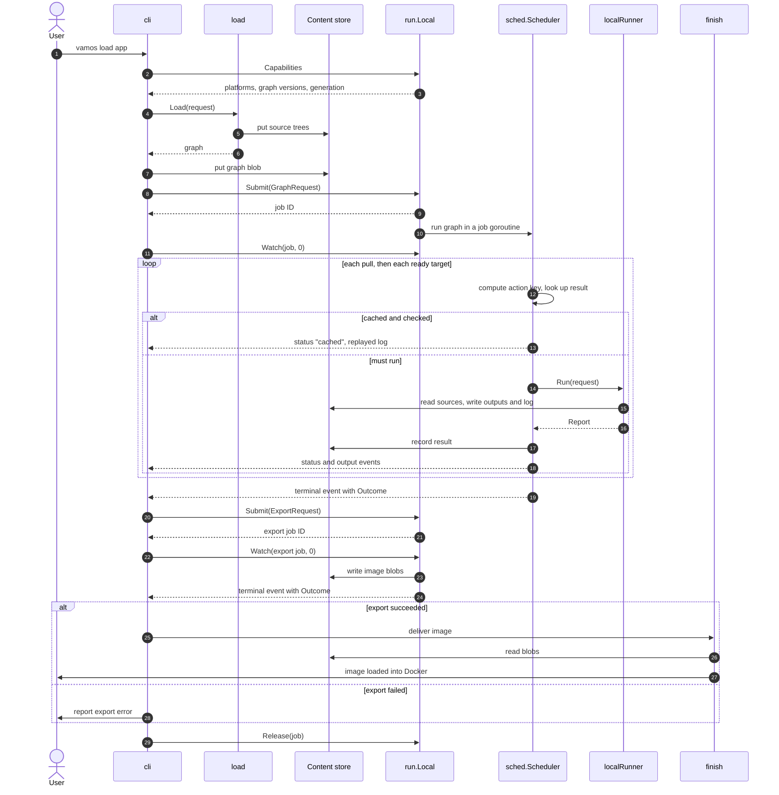

# Client/executor protocol

This document describes the communication contract between client and executor components:
the API interface, job submission lifecycle, data structures, and destination delivery jobs.
The protocol enables the client to operate identically whether executing builds locally in-process
or delegating to a remote coordinator.

For the system-level phases and execution topologies, see [Architecture](architecture.md).

## Boundary contract

The communication contract between client and executor is defined in [api](../../internal/api/doc.go).
It consists of plain data structures serializable to JSON, and the `api.Executor` job interface.
Data values contain no host paths, file handles, or runtime library references.
File content is addressed by digest, and container images are identified by ID with explicit storage locations.
Values cross the boundary by copy, ensuring the executor retains no references to client-side structures.

Secret values are the single exception: they travel directly in memory without JSON serialization,
ensuring that build secrets are never exposed over the network or dispatched to remote coordinators.
Action key calculation for secrets is documented in [Storage and identity](storage.md#action-keys).

The following class diagram shows the `api.Executor` and `cache.ContentStore` interfaces alongside
their concrete implementations.

Clients submit a job request, watch its event stream, and retrieve its final outcome.
Every job represents one operation: executing a graph, pushing an image, publishing tags, exporting blobs,
or pruning cached artifacts.

The following diagram shows the relationships between job requests, streaming events, and final outcomes.

Each [`api.Request`](../../internal/api/doc.go) structure specifies exactly one job type.
The test suite `apitest.Contract` validates that all `api.Executor` implementations adhere to this contract,
and `apitest.JSON` verifies that values round-trip through JSON without loss.

## Local build execution

The following sequence diagram traces the complete execution flow of a local build,
from command invocation through artifact delivery.

In a remote build, the execution sequence follows the same steps through target completion,
except that the client interacts with the executor and content store through `remote.Client`.
A remote coordinator does not export image blobs to the content store:
workers push built layers to a shared cache registry, and the client finish phase reads images directly from there.

## Push, publication, and export jobs

Push, publish, and export operations are modeled as jobs so they execute where container images reside:

- A **push job** transfers an image from the executor's container store or a worker's cache repository
  to a destination registry using executor credentials.
- A **publication job** executes a two-phase delivery: it uploads all images by digest first,
  and writes registry tags only after every upload succeeds.
  On a coordinator, workers handle all registry interaction; the coordinator process itself never touches registries.
  Detailed publication mechanics are described in [Container builds and delivery](container-builds.md#publications).
- An **export job** publishes an image's layers and manifest as blobs into the content store,
  enabling client-side delivery to load the image into a local Docker daemon or write an OCI archive.

The [transfer](../../internal/transfer/doc.go) package provides shared image copying and progress tracing
used by both client and executor.
