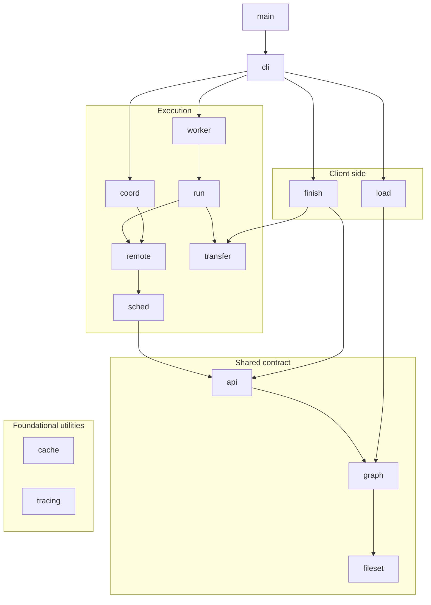
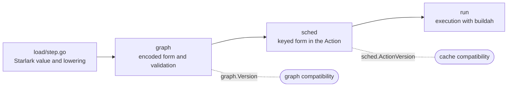

# Package layering and dependencies

This document describes the internal package hierarchy of vamos: import dependency rules,
boundary isolation rationale, architectural verification, and the procedure for extending
the build language with new steps.

For the system-level phases and execution topologies, see [Architecture](architecture.md).

## Package dependencies

Package import rules enforce strict architectural layering across the codebase.
The following diagram shows the permitted import dependencies among vamos packages, omitting transitive edges.
Import edges to `cache` and `tracing` are omitted from the diagram for clarity.
Neither package is imported everywhere: `TestImportRules` limits `fileset` to `[cache]`
and `graph` to `[fileset, cache]`, so neither of those may import `tracing`.

## Architectural boundaries and verification

Package boundaries are verified by unit tests: [TestImportRules](../../internal/deps_test.go) fails
if any package introduces an unauthorized direct or transitive dependency.
These constraints isolate heavy runtime dependencies to the packages that require them.
The boundary rules enforced by the test suite are:

| Boundary | Rationale |
| --- | --- |
| `load` imports neither `buildah`, container storage, `run`, nor `finish` | Target loading can execute on lightweight hosts where buildah is unavailable |
| `run` and `worker` import neither Starlark, `load`, nor `finish`, and `worker` must not import `cli` | Executors require only the serialized graph and content addresses; workers do not depend on the CLI |
| `api`, `sched`, `remote`, and `coord` import neither `buildah`, container storage, nor Starlark | Coordinators and client stubs coordinate execution without runtime image tools |
| `finish` imports neither `buildah`, container storage, `load`, nor `run` | Artifact delivery reads completed results, not in-memory loader or executor state |
| `cache` and `tracing` import no other internal packages | Foundational utilities must remain dependency-free |

The root entry point [main.go](../../main.go) handles process re-execution initialization,
CLI command dispatch, and root error reporting.
All subsystem implementation resides under `internal/`.
Sample modules under [examples/](../../examples/) are separate test workspaces
and not part of the internal package graph.

## Extending the build language

Adding a build step requires coordinated updates across four packages, reflecting the full pipeline from
language evaluation to execution.

The following diagram shows the sequence of packages modified when adding a build step,
along with the compatibility version updated in each.

Compatibility across versions is guarded by two independent version identifiers:
- `graph.Version` increments when the serialized representation or validation of a graph changes.
  An executor verifies this version to ensure it does not misinterpret a graph submitted by a newer client.
- `sched.ActionVersion` increments when cache key computation or execution semantics change.
  Updating this version invalidates obsolete cached results, preventing older build outputs from being reused
  under altered step behavior.
