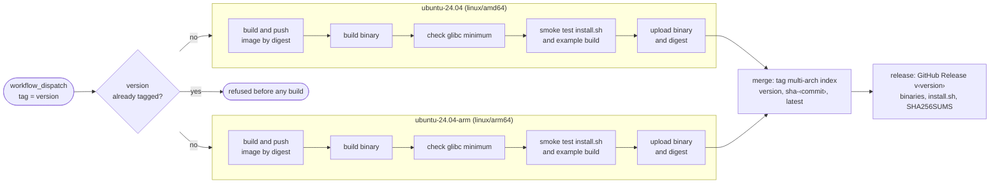
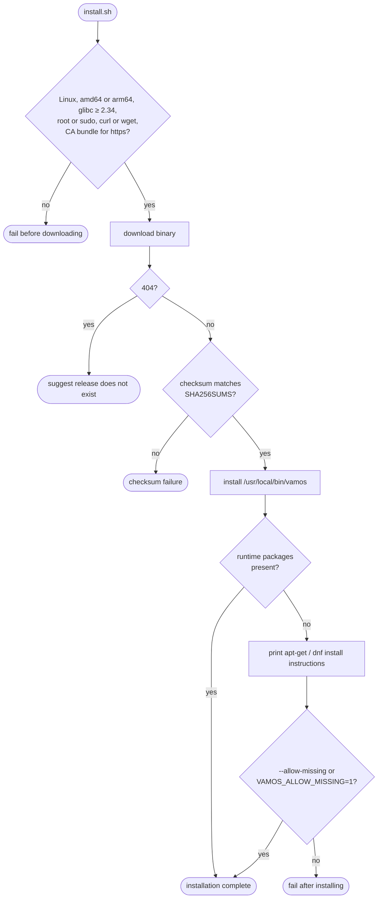

# Releases

This document describes how vamos is built, tested, packaged, and distributed: the multi-architecture release pipeline,
binary portability and glibc requirements, packaging decisions, and the installation script design.
Operational instructions for triggering a release are in the
[contributor guide](../../.agents/kb/remote-environment.md#releases).

A release publishes the multi-architecture container image `ghcr.io/vamos-build/vamos`
as an OCI index supporting `linux/amd64` and `linux/arm64`,
alongside a GitHub Release containing architecture-specific binaries, checksums, and the installer script.

## Release pipeline

The [release workflow](../../.github/workflows/release.yml) executes only upon manual dispatch via `workflow_dispatch`,
never on pull requests or code pushes.
This gate prevents unnecessary multi-architecture container builds
and ensures production deployments adopt new releases deliberately.

The following diagram shows the multi-architecture release workflow,
building and testing each platform natively before publishing.

The release pipeline enforces specific delivery guarantees:
- **Untagged digests until verified**: Each runner job pushes its platform image to the registry strictly by digest
  before executing validation checks.
  Only runners whose tests succeed upload their image digests to the merge job.
  The merge job creates and tags the multi-platform index only when all architecture runners succeed;
  a test failure leaves an untagged blob in the registry and publishes no release.
- **Immutable versioning**: An explicit semantic version tag is required (e.g. `0.1.0` or `0.2.0-rc.1`).
  If the git tag already exists, the workflow halts before building, preventing accidental overwrites.
- **Tag conventions**: The multi-platform index receives the semantic version and `sha-<commit>` tags;
  non-prerelease versions also receive the `latest` tag.
  Git release tags include a leading `v` (e.g. `v0.1.0`),
  while container image tags omit the `v` to match standard OCI conventions.
- **Embedded version metadata**: The Dockerfile's `VERSION` build argument stamps the version string
  (including the `v` prefix) directly into the binary during compilation,
  enabling `vamos --version` to report the version even when built without a `.git` metadata directory.
- **Minimal credentials**: The workflow pushes to GitHub Packages and creates GitHub Releases
  using the short-lived runner `GITHUB_TOKEN`, requiring no external credentials.

## Portability and packaging decisions

The build configuration balances runtime portability against minimal dependencies:

| Architectural decision | Rejected alternative | Implementation rationale |
| --- | --- | --- |
| Build each platform natively on native runners | Cross-compile on a single runner | buildah's Linux namespace setup requires cgo; cross-compiling cgo requires complex cross-toolchains, and building Go under QEMU emulation is substantially slower. |
| Build on Debian 12 base with glibc 2.36 | Build on newer distributions | Binaries must execute reliably on standard Linux hosts; Debian 12's glibc 2.36 is older than Ubuntu 24.04's glibc 2.39. |
| Link exclusively against glibc (`containers_image_openpgp`, `exclude_graphdriver_btrfs`) | Link dynamic `gpgme` and `btrfs` libraries | Stripping external C library dependencies ensures the binary runs on distributions where specialized storage drivers or GPG libraries are uninstalled. |
| Dynamic binary linked to glibc | Fully static binary with `CGO_ENABLED=0` | When cgo is disabled, buildah's chroot isolation routines fail to execute target `run` steps. |
| Smoke test on native runners | Smoke test under QEMU emulation | buildah cannot re-execute itself under foreign architecture emulation. |

CI verifies that the binary requires no glibc symbols newer than 2.34;
`install.sh` requires host glibc 2.34 or later.
Each runner job scans the compiled binary against this glibc ceiling;
introducing a newer symbol dependency immediately halts the release.
Because developer container builds and unit tests retain `gpgme` and `btrfs` dependencies,
changes to image verification or storage logic must be validated against release build outputs.

## Installation with install.sh

`install.sh` is the canonical installation script for vamos.
It is designed for execution within container Dockerfiles (pinned to an explicit release version URL)
or on developer machines (downloading the latest release).

The release publishes standalone architecture binaries (`vamos-linux-amd64` and `vamos-linux-arm64`)
extracted from the Dockerfile's `binary` build stage, alongside [install.sh](../../install.sh) and a `SHA256SUMS` file.
The published container image also contains the binary at `/usr/local/bin/vamos`.

The following diagram shows the preflight checks, download verification, and package detection
performed by `install.sh`.

The installer script incorporates specific reliability safeguards:
- **No package manager modification**: The script does not invoke `apt-get` or `dnf` automatically,
  allowing Dockerfiles to control package manager layers explicitly.
  If required runtime dependencies (`ca-certificates`, `containers-common`, or `netavark`) are missing,
  the script prints the required package installation command and exits with an error
  unless passed `--allow-missing`.
- **Preflight HTTPS validation**: The script verifies that local CA trust certificates exist
  before attempting to download assets.
  This diagnostic prevents confusing failures on minimal base images where `curl` was installed
  without `ca-certificates`.
- **Single-command execution**: In container Dockerfiles, the script is downloaded, executed, and unlinked
  within a single `RUN` layer, preventing residual script files from lingering in container layers.
- **Testing hooks**: Setting `VAMOS_RELEASE_URL` overrides the asset download location,
  allowing release smoke tests to validate unreleased binaries before publishing tags.
