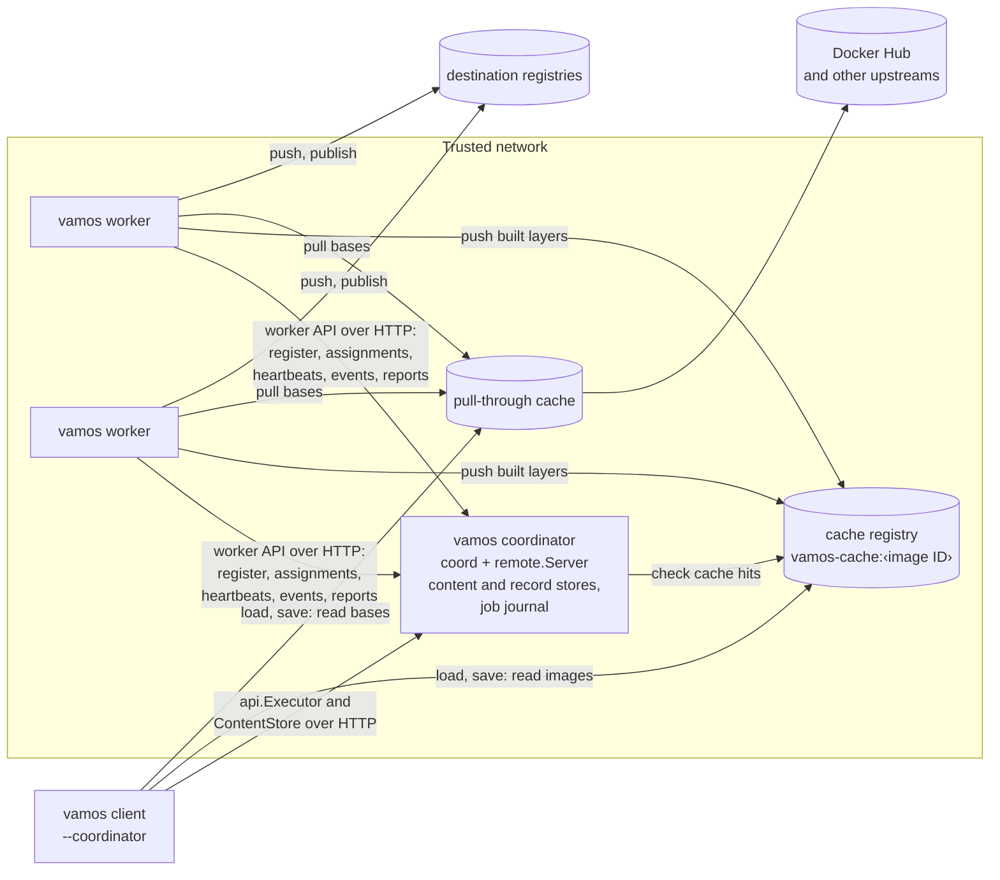
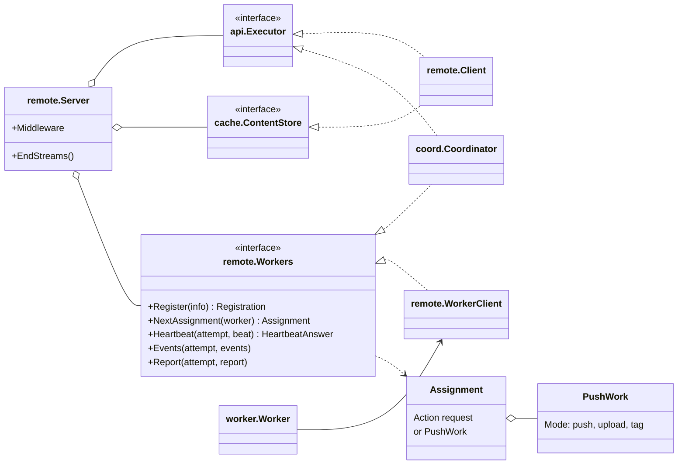
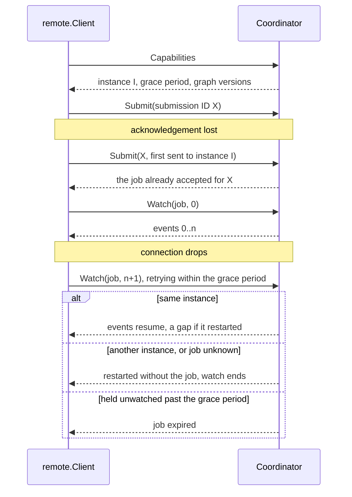
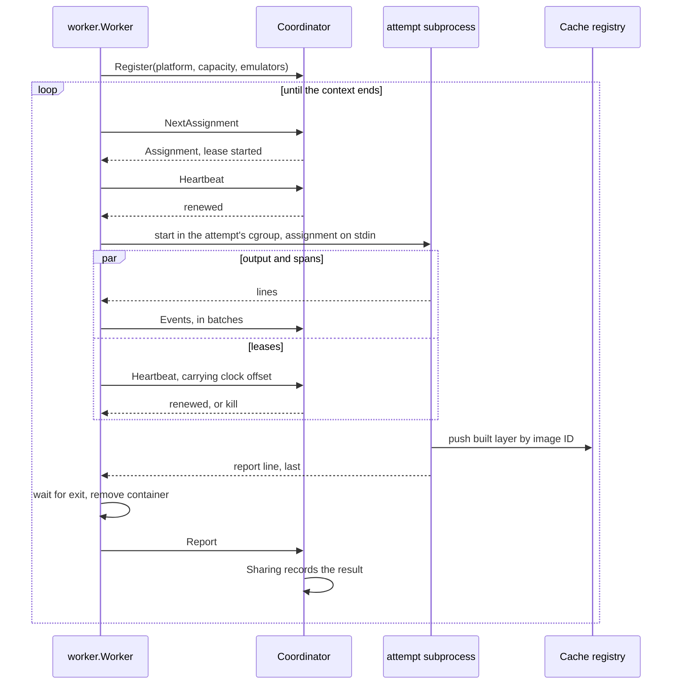
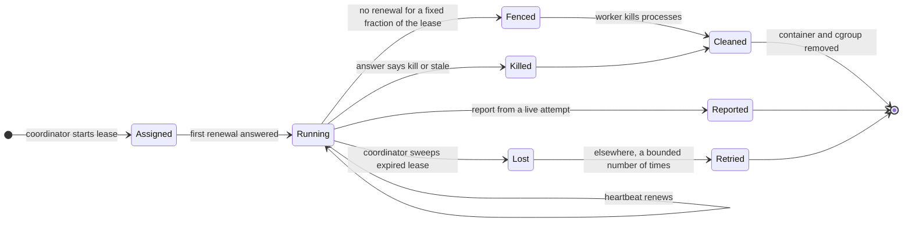
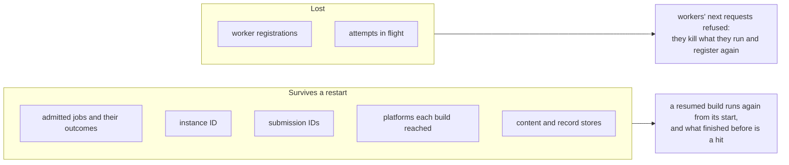
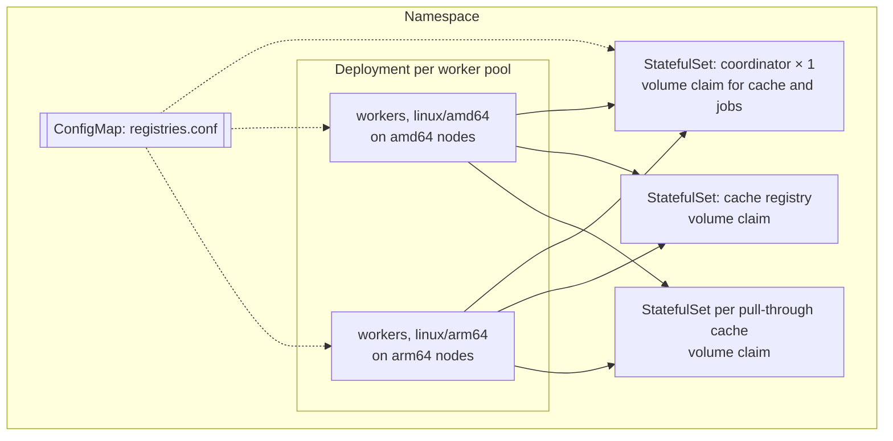

# Remote execution

This document describes remote execution in vamos: the distributed topology of coordinator and workers,
communication protocols, attempt leasing and worker fencing, crash recovery, and Kubernetes deployment.
Instructions for launching the local development environment are in the
[contributor guide](../../.agents/kb/remote-environment.md).

## Distributed topology

Remote execution offloads target execution from developer workstations to a coordinator service and worker pool
sharing a central cache registry and pull-through caching proxy.
The client-side interface remains identical: clients interact with the coordinator through `api.Executor`,
just as they would with a local in-process executor.

The following diagram shows the network topology and interactions between client, coordinator, workers,
and registries.

The distributed topology assigns specific responsibilities to each component:

| Component | Architecture role |
| --- | --- |
| Coordinator | The `vamos coordinator` service, combining [coord](../../internal/coord/doc.go) and [remote](../../internal/remote/doc.go). It schedules submitted graphs across workers, manages shared record and content stores, and validates cache hits against the cache registry. It does not mount container storage or execute actions directly. |
| Worker | The `vamos worker` daemon from [worker](../../internal/worker/doc.go). It executes assigned attempts in isolated subprocesses, pushes built layers to the cache registry, and pulls base images through the pull-through cache proxy. |
| Cache registry | A standard OCI registry holding built layers tagged as `<repository>:<image ID>`. Catalog tag deletion is enabled to support cache pruning. |
| Pull-through cache | A read-only caching proxy mirroring upstream registries (such as Docker Hub) to prevent upstream rate limits. Upstream credentials reside on the proxy. |

Registries are standard CNCF Distribution instances with no proprietary extensions.
The coordinator process never contacts external destination registries directly:
pushes and publications execute on worker nodes using the workers' local credentials.

The coordinator advertises registry access configurations in `api.Capabilities.Registries`.
This configuration maps repository prefixes matching `registries.conf` patterns,
instructing clients where to read completed image outputs.
CLI operations such as `vamos update` and pin recording query upstream registries directly
rather than through caching proxies.

Authentication is not yet implemented; all HTTP endpoints route through `remote.Server.Middleware`
where future authentication layers will reside.
Coordinators and registries must be deployed exclusively within trusted private networks.

## The remote communication package

The internal `remote` package implements client and server adapters for the executor protocol.

The following class diagram shows the interfaces, HTTP handlers, and clients in the `remote` package.

Data transfer adheres to strict serialization formats:
- Protocol metadata serializes as JSON matching `api` structures.
- Blobs stream as raw HTTP request bodies, verified by sha256 checksums on both read and write.
  This verification distinguishes transmission corruption from missing objects.
- Subsystem sentinel errors are encoded as structured error codes, ensuring `errors.Is` matches correctly on clients.

### Recovering from disconnected connections

The following sequence diagram shows how `remote.Client` resumes watch subscriptions
and recovers from transient connection drops.

Communication is designed for network fault tolerance:
- Submissions (both `Submit` and `Prune`) include a client-generated UUID.
  If an acknowledgement is lost, resubmitting with the same UUID returns the existing job handle
  without duplicating execution.
- Submissions record the coordinator instance ID;
  a failover coordinator with a different instance ID rejects the retry, preventing ambiguous execution states.
- Idempotent inspection and cancellation operations (`Cancel`, `Release`, and `Result`) operate on an existing `JobID`
  and retry transport failures automatically.
- Blob downloads resume from byte offsets if connections drop during transfer.

## Workers and attempt execution

Workers register their platform architecture, runtime version, concurrency capacity, and supported emulators,
then poll for assignments via long-polling HTTP requests.
Each assigned action executes in a dedicated subprocess of the worker binary within an isolated cgroup,
guaranteeing that process termination catches background processes spawned by build commands.

The following sequence diagram shows the worker lifecycle: registration, assignment polling, lease renewals,
attempt execution, and report delivery.

Execution timing enforces strict ordering:
- A worker spawns the attempt subprocess only after its initial lease renewal succeeds,
  compensating for transmission latency during assignment dispatch.
- Output logs and trace spans stream through bounded in-memory buffers;
  if the coordinator slows down, backpressure slows subprocess output rather than exhausting worker memory.
  Live event delivery is best-effort: if sending an event batch over HTTP fails,
  the worker logs the error and discards the batch rather than requeuing it.
- The worker estimates clock skew against the coordinator across heartbeat responses,
  and the coordinator adjusts span timestamps by this offset to align traces accurately.

### Leases and monotonic fencing

The coordinator grants execution leases that expire if heartbeats cease.
However, terminating a process does not guarantee immediate exit;
a process in uninterruptible disk sleep may outlive a termination signal and its lease.
The coordinator therefore relies on **monotonic fencing**:
any report submitted after an attempt's lease has expired is permanently rejected.

The following state diagram shows attempt lease states and fencing transitions.

Fencing operates through cooperative timeouts:
- The worker calculates lease expiration using its local monotonic clock.
  It fences an attempt at a conservative fraction of the lease duration,
  measured from when the heartbeat request was *sent*.
  Because the coordinator renews the lease upon receipt,
  this timing ensures that the worker issues the termination signal
  before the coordinator's view of the lease can expire.
- Cgroup cleanup waits a bounded interval for processes to terminate before unlinking the cgroup.
  If processes remain stuck in uninterruptible sleep, cleanup logs a warning and yields;
  re-registering workers clean up residual cgroups during initialization.
- If a heartbeat times out, the worker treats it as a transport failure governed by the monotonic fence.
  If the coordinator explicitly answers that an attempt is stale or cancelled,
  the worker kills the attempt immediately.
- Actions lost due to dead workers are re-queued and dispatched to healthy workers up to a bounded retry limit.
  Digest-based layer uploads in publications can safely be reassigned on worker loss.
  However, final image pushes and publication tag-writing attempts are never reassigned to another worker
  if a worker is lost, because external registry writes may have already succeeded.
  (Within a live attempt, transient network errors during individual registry HTTP calls are retried normally.)

### Assignment

The coordinator dispatches work using balanced scheduling priorities:
1. Actions from builds with the fewest currently running attempts are dispatched first.
2. Older actions within a build take priority over newer ones.

Platform matching guarantees native execution:
- Actions execute on their native architecture if registered workers support it.
- If no native workers exist, actions execute on the build's execution platform under emulation.
- Emulated actions are assigned exclusively to workers of the execution platform that advertise an emulator
  for the target architecture.
- Once a build begins running actions natively on a given platform,
  the coordinator records that platform in the build's journal;
  even across coordinator restarts, actions for that target will never silently fall back to emulation.

If all workers for a required platform disconnect, the build pauses, emits a diagnostic waiting event,
and remains paused until matching workers reconnect or the client cancels the build.

## Coordinator crash resilience

The coordinator maintains runtime state in memory, but persists build state to disk
when configured with `Config.State`.
State is stored in a designated directory containing an `instance` metadata file and individual job records
under `jobs/<id>.json`.
Each record is written to a temporary file, flushed to disk with `sync`, and atomically renamed into place.
This allows active builds to resume transparently after process restarts.

The following diagram shows which coordinator state is preserved in the disk journal versus state
that is discarded and reacquired.

Journaling enforces specific crash invariants:
- A job's record is written, synced, and renamed into place immediately upon admitting the job,
  before returning the submission response to the client.
  An exclusive lock file (`lock`) in the state directory prevents multiple coordinator processes
  from accessing the state.
- Push, publication, or pruning jobs interrupted by a crash fail immediately upon recovery,
  since partial external registry modifications cannot be safely resumed.
- Intermediate journal updates during execution are best-effort:
  if a disk write fails, the coordinator logs a warning and continues in memory.
  On restart, the job recovers from its last successfully synced checkpoint.
- Critical recovery records—such as updating restart counters or finalizing completed outcomes—must succeed;
  if recovery fails to sync to disk, the coordinator halts startup.
- Recovered event streams begin after the highest event index emitted prior to the restart,
  causing resumed client watch streams to encounter an explicit restart gap event.

## Kubernetes deployment

The Helm chart in [remote/helm/vamos](../../remote/helm/vamos/values.yaml) deploys vamos services to Kubernetes.

The following diagram shows the Kubernetes deployment topology defined in the vamos Helm chart.

The Kubernetes resources are designed for specific operational requirements:

| Resource | Implementation rationale |
| --- | --- |
| Coordinator StatefulSet (replicas: 1) | Ensures at most one coordinator process accesses the journal and cache volume claim. Replacements mount the persistent volume after the prior pod terminates. |
| Worker Deployments (one per platform) | Deploys distinct worker pools to architecture-matched nodes, enabling native execution across `linux/amd64` and `linux/arm64`. |
| Worker `emptyDir` storage | Places buildah container storage on node-local ephemeral disks; storage survives worker container restarts to clean up residual attempts, but is discarded with the pod. |
| Dedicated worker cgroup namespaces | Isolates attempt cgroups from node-level Kubernetes cgroup hierarchies (see below). |

In standard Kubernetes environments, privileged containers share the host node's cgroup namespace.
If multiple worker pods ran directly in the host namespace, they would all share `/sys/fs/cgroup/vamos`,
causing workers on the same node to inadvertently kill each other's child processes during cleanup.
To prevent this, worker containers initialize in an isolated cgroup namespace using `unshare --cgroup --mount`
and mount cgroup2 directly over `/sys/fs/cgroup`,
ensuring the worker process roots its cgroup hierarchy within its own pod boundaries.

Clients resolve the coordinator and registry services using internal Kubernetes DNS names.
CLI commands such as `vamos build` communicate exclusively with the coordinator;
operations like `vamos load`, `vamos save`, and client-side publications connect to the cache registries directly
using the endpoints reported in coordinator capabilities.
