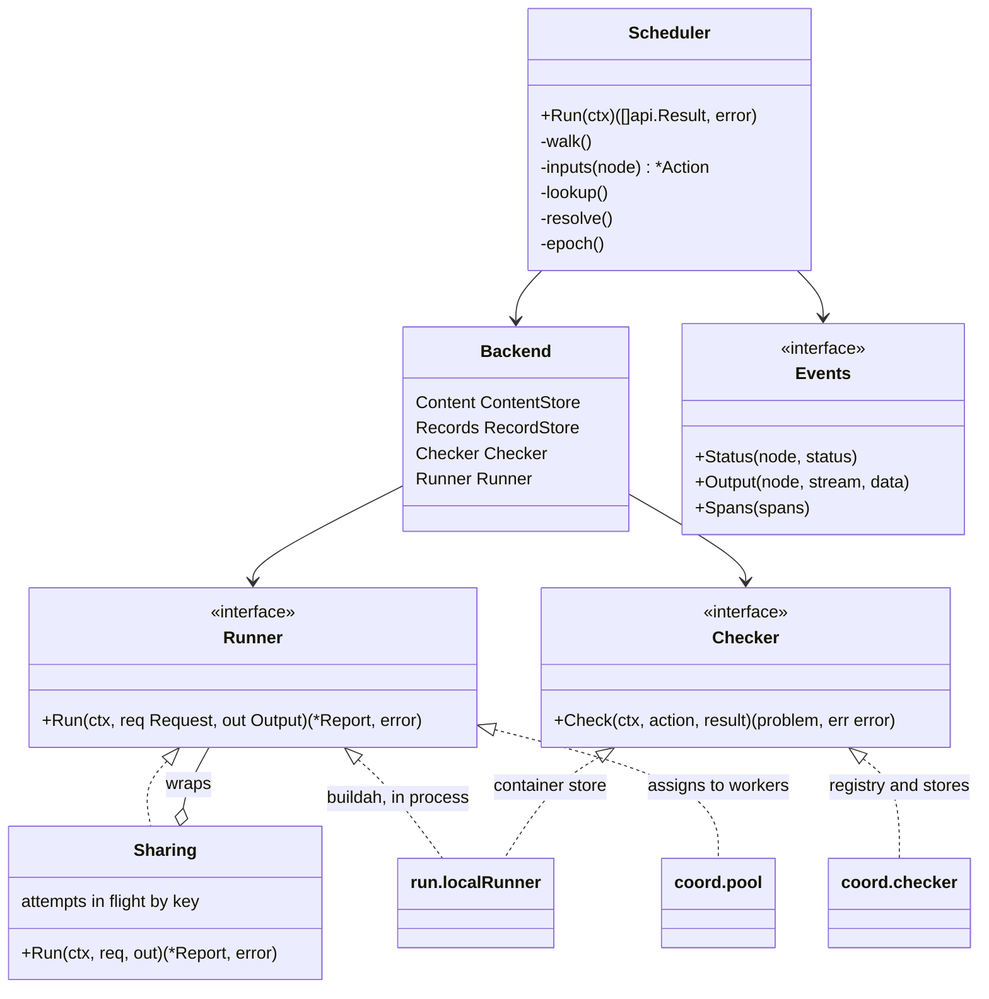
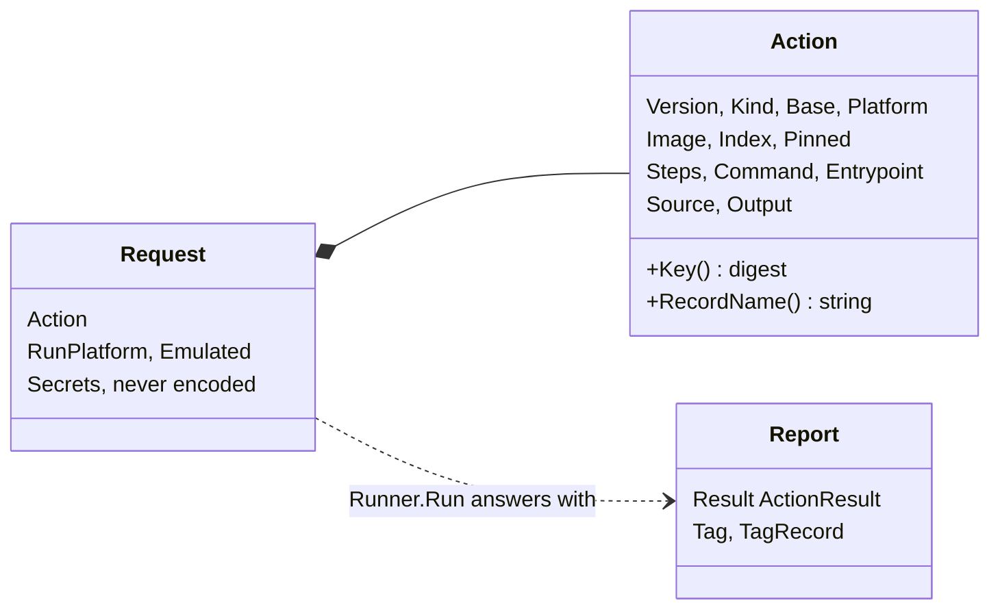
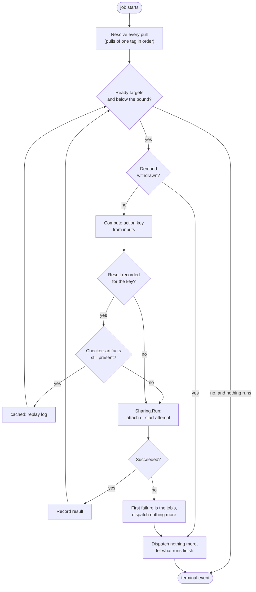
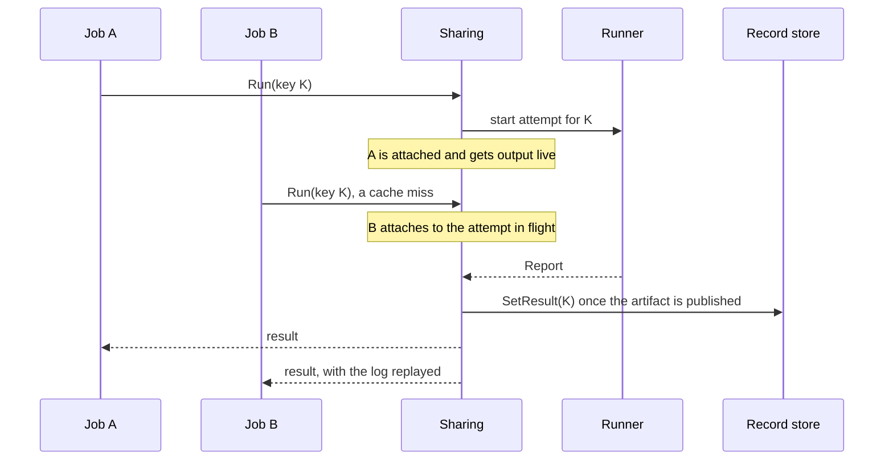
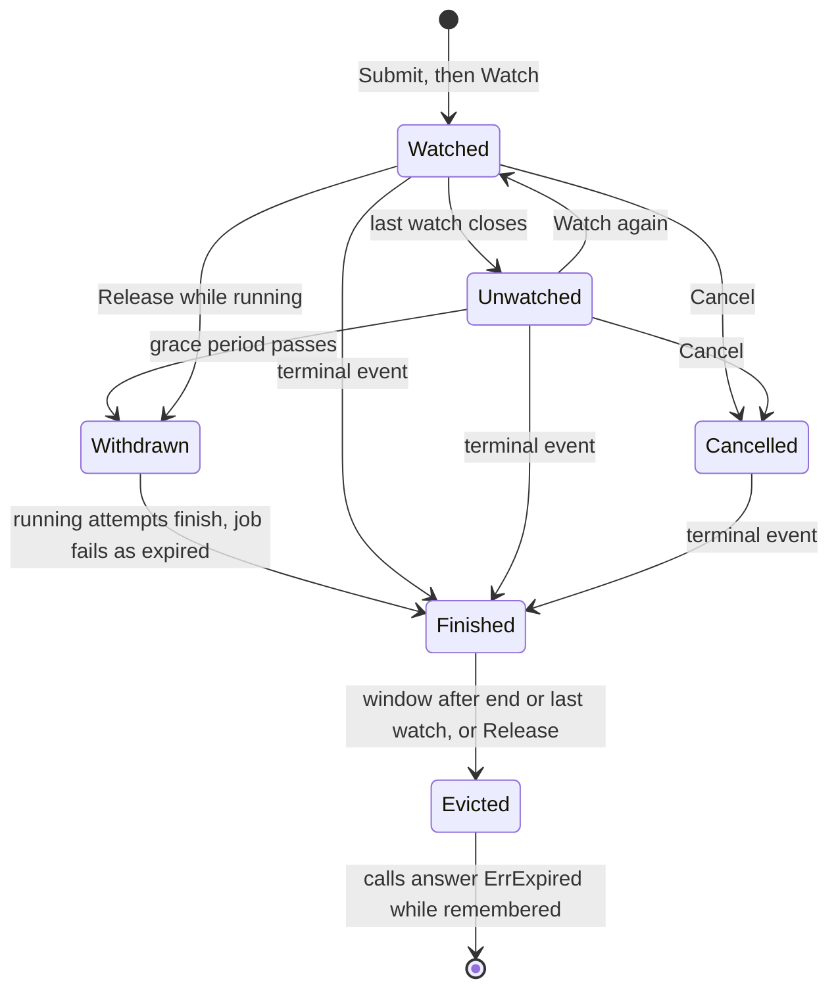
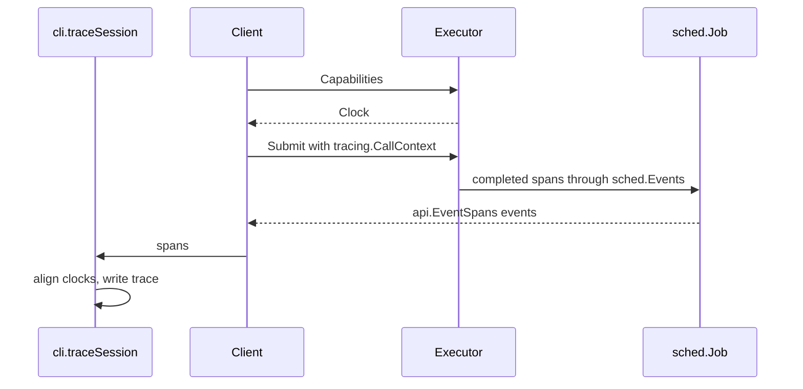
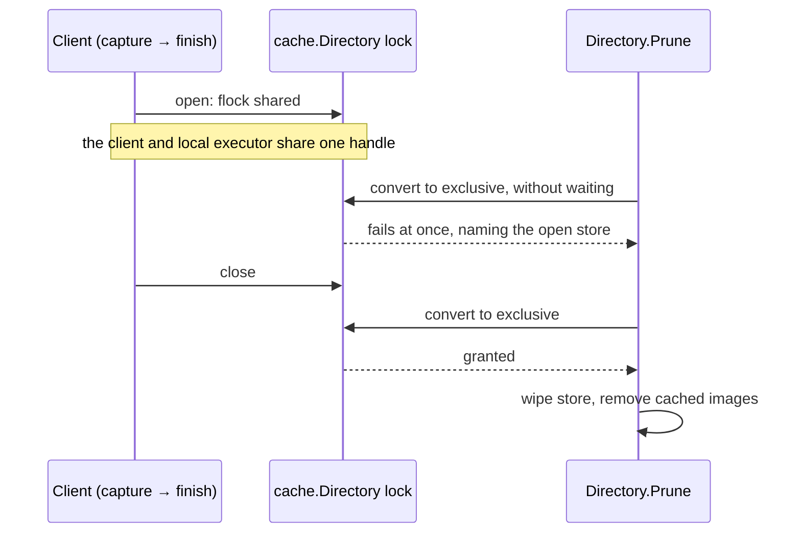

# Scheduling and concurrency

This document describes the scheduling and concurrency model in vamos: how the scheduler traverses target graphs,
coordinates runner backends, deduplicates concurrent attempts, streams events, and enforces synchronization.

Both the local executor and the remote coordinator schedule graph execution using [sched](../../internal/sched/doc.go).
The scheduler walks the target graph in topological order, computes action keys, inspects cached results,
and submits un-cached actions to a `Runner` implementation.
Concurrent jobs requesting identical actions share in-flight execution attempts,
and the runner's completed outputs are written to the record store.
`sched` imports neither buildah, container storage, nor Starlark.
This decoupling keeps the `sched` and `coord` packages, which coordinate work without executing actions directly,
free of container runtime and evaluation dependencies.
It is a package boundary, not a binary one: the single `vamos` executable serves every subcommand,
including `coordinator`, and still links those libraries through the CLI.

## The scheduler and backend interfaces

The following diagram shows the scheduler and its backend interfaces, along with local and coordinator implementations.

The following diagram shows the action inputs and reports exchanged between the scheduler and runner.

The scheduler and the runner share no in-memory state other than access to the content store.
A [`sched.Request`](../../internal/sched/doc.go) carries all inputs an action requires,
including resolved tag records for pull actions;
the runner does not read the record store or the target graph directly.
Requests and reports serialize to JSON for transport between the coordinator and workers over HTTP.
Only `sched.Sharing` writes to the record store, and only after the runner has published target artifacts
and returned its report.
This sequencing guarantees that the record store never references missing artifacts;
when concurrent writes occur, the latest write wins.

## Walking a graph

The following diagram illustrates how `Scheduler.walk` processes pulls, evaluates cache hits, and dispatches actions.

Graph execution proceeds in two stages:

1. **Pull resolution**: Every base image pull resolves before any build target begins.
   Pulls referencing the same tag resolve sequentially in declaration order to maintain deterministic tag selection.
2. **Target dispatch**: Ready nodes whose dependencies have completed dispatch concurrently
   up to the concurrency limit configured in `sched.Options.Bound`.

In the local executor, `Bound` is set to 1, executing ready targets sequentially.
The coordinator configures a higher bound, using a worker pool runner that distributes actions across workers.

When a target fails, the scheduler dispatches no further work.
Targets currently executing are allowed to finish and record their results.
The first failed target determines the job failure outcome, which the client maps back to its local graph.
Internal state maps in `walk` are modified exclusively by the main scheduling goroutine between dispatches;
running actions read only their immutable request values and the storage layers.

## Sharing execution attempts

An **attempt** is a single execution of an action.
Multiple concurrent jobs requiring the same action key share a single attempt managed by `sched.Sharing`.

The following sequence diagram shows two jobs requesting the same action key concurrently,
sharing a single in-flight attempt through `sched.Sharing`.

Sharing operates under specific coordination rules:
- **Cache miss attachment**: An ordinary job encountering a cache miss attaches to an existing in-flight attempt
  for that action key, including an attempt initiated by a forced rebuild.
- **Forced rebuilds**: A job running with `--rebuild` bypasses cache lookups and does not attach to existing attempts.
  Its new attempt replaces any previous attempt for that key, and subsequent jobs attach to the new execution.
- **Result delivery**: Each attempt delivers its outcome to all attached jobs,
  and the latest completed attempt updates the record store.
- **Cancellation**: Cancelling a job detaches that job from its shared attempt.
  An attempt continues running as long as at least one job remains attached;
  it is cancelled only when all attached jobs have detached.
- **Trace spans**: Attempt trace spans route to the trace session of the job that initiated the attempt.
  If that job detaches while other jobs remain attached, subsequent spans are dropped so the initial job
  produces no further events after its final flush.
- **Intra-job deduplication**: Nodes within a single job that share an identical action key
  (such as multiple platform variants of an index running a task on the execution platform)
  share an attempt unless a rebuild is forced.

Emulation permission governs whether an action may be dispatched under an emulator.
A job without emulation permission may attach to an in-flight emulating attempt,
because the completed artifact is valid for reuse, but it cannot start an emulated attempt itself.
When an unpermitted action requires emulation, the scheduler reports a platform mismatch error
specifying both the requested platform and the host platform, along with the options to resolve it
(enabling emulation with `--emulate` or running on a native worker).
Conversely, a job configured to run an action natively never attaches to an in-flight emulated attempt;
it starts a native attempt to avoid waiting on an emulator.

## Job lifecycle, events, and demand

The `sched.Jobs` registry manages all active jobs on an executor.
Each job runs in its own goroutine with a context that terminates only upon cancellation via `Cancel`.
Jobs stream progress events to a bounded buffer that enforces limits on both event count and total bytes.
Clients read events by position without blocking execution:
- If a client requests a position that has expired from the buffer, the stream emits a gap event.
- If a client falls behind the stream write buffer, the watch connection drops with `api.ErrFellBehind`,
  requiring the client to reconnect from its last received position.

A job's demand is defined by the presence of active client watch connections.
`Jobs` tracks the number of open watches on each build.
On a coordinator, builds configure a demand grace period:
if a build remains unwatched longer than the grace period, its demand is withdrawn.
When demand is withdrawn, running attempts finish and record their results, but no new actions are dispatched.
Explicit cancellation, by contrast, terminates the job's context immediately,
detaching it from all in-flight attempts.

The following state diagram shows the lifecycle of a job,
tracking client watch attachments, demand expiration, cancellation, and eviction.

In the local executor, no grace period is configured, so jobs never expire from lack of demand.
On a coordinator, a periodic sweep routine calls `Jobs.Sweep`,
which enforces the grace period and evicts completed jobs after their retention window passes.
While an attempt is queued for worker assignment, the worker pool polls `sched.Demanded` and `sched.Permitted`
at each heartbeat interval.
If all attached jobs have disconnected or cancelled,
or if an emulated attempt is no longer permitted by any attached job,
the pool cancels the queued attempt to prevent unneeded work.

### Cancellation

Cancellation takes effect at boundaries between non-interruptible steps:
between shell commands within buildah, between file transfers during checkout,
between replayed log records, between directory scans during capture,
and between statement evaluations in BUILD files.
Calling `Local.Close` cancels all active jobs, waits for running goroutines to exit,
removes lingering container state and temporary files, and returns any encountered errors.

## Concurrency and callbacks

Event listeners and progress consumers do not run in lockstep with the target scheduler:
file streaming, container layer extraction, and standard output delivery execute across multiple goroutines,
and distinct jobs run concurrently within the executor.
When invoking callbacks, data buffers may be shared, callback functions may execute in parallel,
and invoking client callbacks while holding internal mutexes can induce latency spikes or deadlocks.
Synchronization contracts are documented alongside the symbols that enforce them:
`sched.Events`, `spanBatch`, `blobTracker`, `cache.LogRecorder`, `tracing.Recorder`, `tracing.Active`,
`cli.eventPrinter`, and `cli.traceSession`.

## Trace transport

Trace telemetry spans cross subsystem boundaries before assembling into the client's final trace export.
Each job must complete span emission before flushing its terminal event.

The following sequence diagram shows how trace spans are captured during execution,
transported via events, and aligned to the client clock.

Trace collection follows specific protocol stages:
1. The client attaches a `tracing.CallContext` to executor submission requests.
2. The executor emits completed spans through `sched.Events`,
   which the job packages into `api.EventSpans` events in the stream.
3. The client's `cli.traceSession` receives the spans and adjusts their timestamps
   using the clock offset reported in `api.Capabilities.Clock` before writing the trace file.

When tracing is disabled, no trace structures are allocated and span collection overhead is skipped.
Span hierarchy, flow endpoints, and encoding formats are managed by [tracing](../../internal/tracing/doc.go).
Network progress tracking in [transfer.go](../../internal/transfer/transfer.go) wraps containers/image progress
events through `blobTracker`; because image configurations may report completion without transferring bytes,
progress events reflect transfer progress rather than an absolute network audit.

## Cache directory locking

Disk-based storage in `cache.Directory` relies on filesystem operations rather than a process-wide build lock,
and does not provide multi-resource transactional rollbacks across graph blobs and container layers.
However, cache pruning and regular build operations exclude each other using a local file lock.

The following sequence diagram shows mutual exclusion between a client build holding a shared lock
on `cache.Directory` and a prune operation requesting an exclusive lock.

Both build and prune operations request non-blocking locks (`flock`):
- If a prune request encounters an active build holding a shared lock,
  or a build encounters an active prune holding an exclusive lock,
  the operation fails immediately with an error identifying the conflicting store access.
- An executor also rejects prune requests whenever any of its internal jobs are currently running.

This lock operates as a local host kernel lock; it does not coordinate access across multiple network nodes.
On a remote coordinator, cache pruning across concurrent clients is fenced by store generation instead;
see [Storage and identity](storage.md#pruning).
