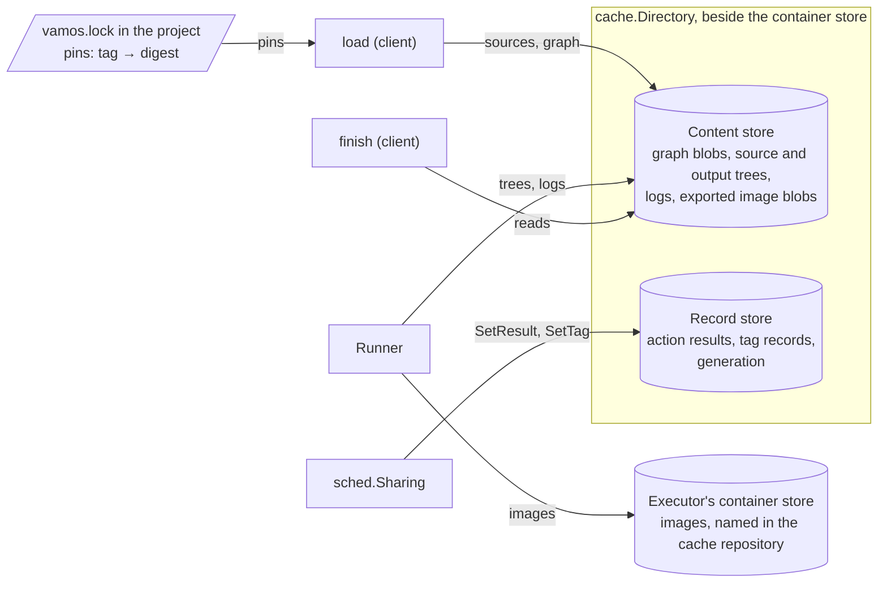
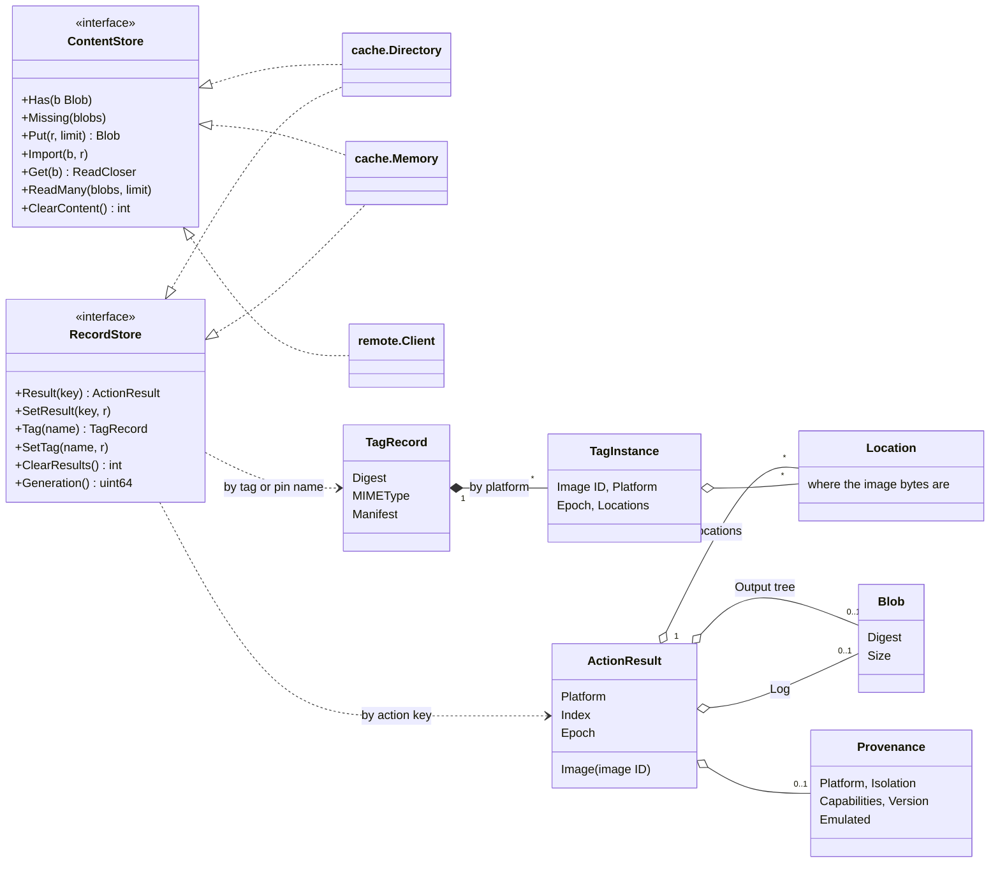
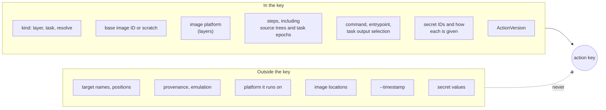
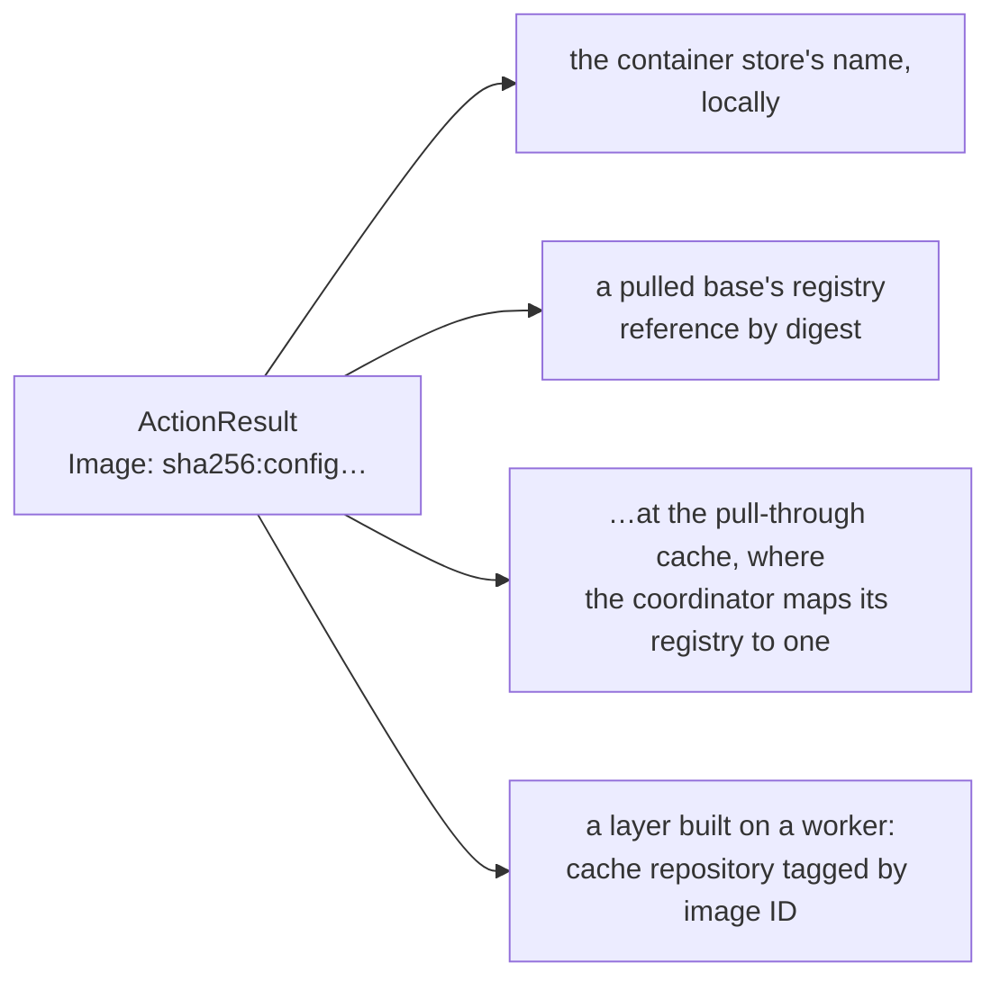
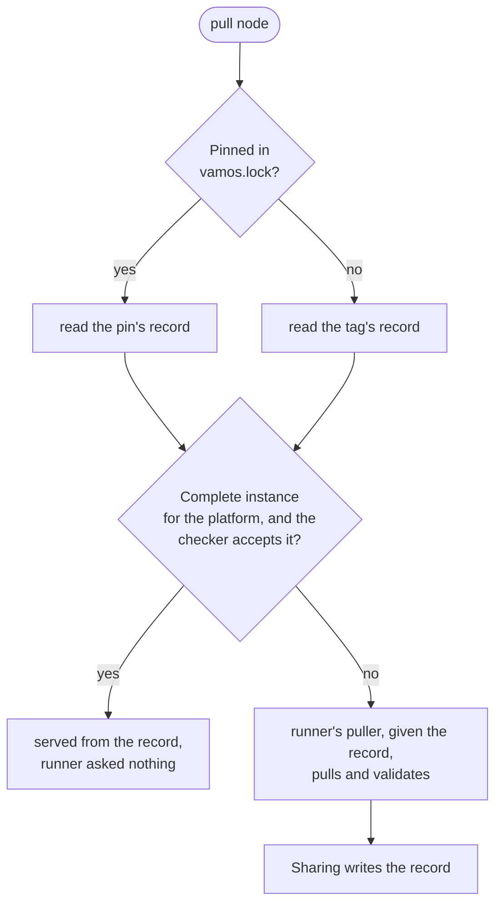
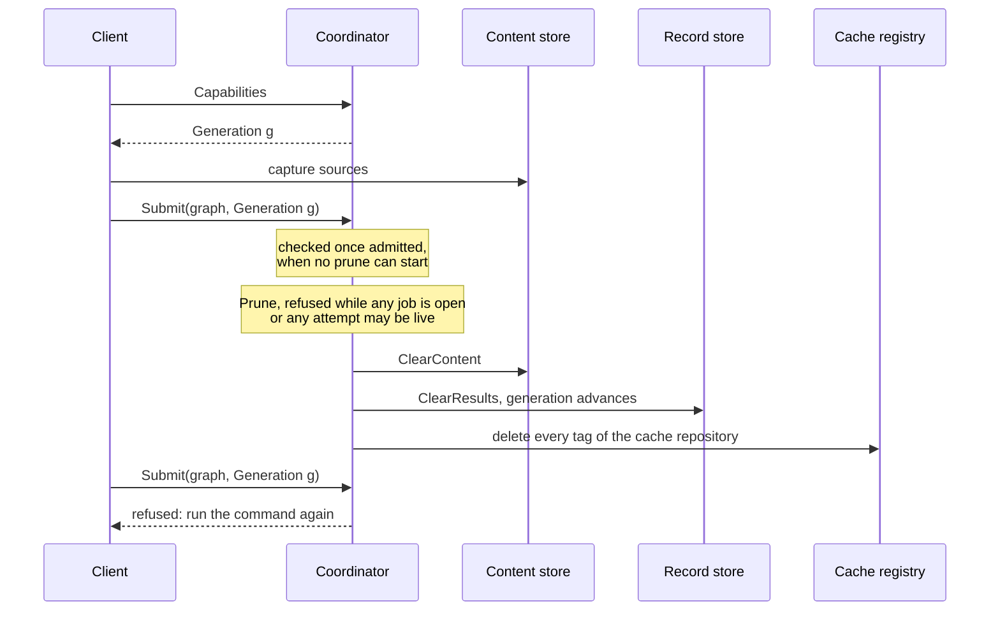

# Storage and identity

This document describes storage, artifact identity, and caching in vamos: the three storage layers,
action key generation, image naming, pin resolution, and cache pruning.

## The three storage layers

Build execution relies on three distinct storage layers:

The following diagram shows the three stores and the data exchanged with the loader, scheduler, runner,
and finish phases.

The three stores serve distinct roles:
- The **content store** is a content-addressed object store holding immutable blobs keyed by sha256 digest:
  serialized graph blobs, source file trees, task output trees, build logs, and exported image layer blobs.
- The **record store** is a key-value store mapping action keys to execution results,
  and image tags to resolved manifest records.
- The **container store** is the executor's underlying buildah storage holding container layer filesystems and images.

The content and record stores are defined as Go interfaces in [cache](../../internal/cache/doc.go):
- `cache.Directory` provides on-disk storage for production builds.
- `cache.Memory` provides an in-memory implementation for automated tests.
- `remote.Client` provides an HTTP proxy client forwarding storage requests to a remote coordinator.

`run.CacheDir` places the on-disk directory store alongside buildah's storage,
typically at `/var/lib/containers/vamos`.
Persisting the `/var/lib/containers` volume preserves both container layers and build metadata.
Client processes obtain their content store handle directly from the executor they connect to.

The following class diagram shows the `cache.ContentStore` and `cache.RecordStore` interfaces,
their implementations, and data structures.

Record metadata alone cannot prove that referenced image layers or file trees remain present on disk.
Content is therefore verified as it is read:

| Corrupted resource | System response |
| --- | --- |
| Task output files in content store | The task re-executes to regenerate output files |
| Captured workspace source files | The build fails; only the client can re-read local files |
| Cached execution log | The result is marked as a cache miss and re-executes |

When a read operation detects a corrupted blob, the store deletes the corrupted file immediately,
allowing subsequent write operations to restore valid content.

## Identities

The system maintains distinct identifiers across the build lifecycle:

| Identifier | Subsystem owner | Purpose |
| --- | --- | --- |
| Configured target | `load.confLabel` | Distinguishing targets across configuration variants |
| Graph blob digest | `graph.Encode`, `api.GraphRequest.Graph` | Content address of an immutable build plan |
| Action key | `sched.Action`, `Scheduler.inputs` | Identifying identical target execution inputs for reuse |
| File tree digest | `cache.Tree` | Addressing file hierarchies independently of file timestamps |
| Image ID / manifest digest | `api.Result`, `cache.TagRecord` | Addressing OCI image configs and registry manifests |

### Action keys

An action key is the sha256 digest of its serialized `sched.Action`.
It incorporates every input that influences the execution outcome, and excludes non-deterministic metadata.
Because action identity is independent of target names or graph position,
renaming a target or moving it within a BUILD file preserves cache hits.

The following diagram contrasts attributes included in an action key with execution metadata
and secret values excluded from it.

Secret management follows strict isolation rules:
- An action key incorporates the secret identifier and its mount path or environment variable binding,
  never the secret's actual plaintext value or the host path where `--secret` read it.
- This design ensures that rotating a secret value does not invalidate cached results when commands did not change.
- Plaintext secret values travel exclusively in memory through `api.GraphRequest.Secrets` and `sched.Request.Secrets`.
  They are never serialized to JSON, written to disk records, or transmitted over network sockets,
  and passing `--secret` is rejected when using `--coordinator`.
- During execution, the runner writes each secret value to a temporary file accessible only to its process,
  mounts it into the buildah container, and unlinks the file immediately after the step finishes.

Action results also record a `cache.Provenance` structure detailing the host platform, isolation mode,
capabilities, version, and whether commands ran under emulation.
Provenance is recorded for diagnostics and inspection, but is excluded from action keys to avoid cache fragmentation.

### Image identity and locations

An image's ID is the sha256 digest of its OCI configuration object.
Pushes and pulls preserve this ID, keeping image identity portable across registries and container stores.

The `run` package tracks all images—whether built locally or pulled from registries—using an internal reference
in the cache repository formatted as `<cache-repository>:<image ID>`.
This abstraction keeps the local container store's internal IDs confined to `run`.
Because external operations on container storage could reassign tags, `run` validates every image before reuse:
it confirms that the tag references an image matching the expected ID,
and that its stored layers match the layer digests in its configuration.
If this check fails, the cached result is treated as a cache miss.
The layer validation also rejects images from partial pulls where `insecure_allow_unpredictable_image_contents`
in `storage.conf` allowed unverified layers whose configurations do not match file contents.

An action result records its image ID along with explicit storage locations:

The following diagram shows the four storage location formats recorded in an `ActionResult`.

Storage locations adapt to deployment topologies:
- When running on a worker, the runner pushes built layers to the shared cache registry before reporting completion.
- If a runner subsequently requires an image not present in its local storage,
  it pulls the image from one of the registry locations listed in the action result.
- The client reads directly from registry locations only during remote coordinator builds;
  in local builds, delivery reads exported blobs from the local content store.

## Lockfile pins and repository tags

The project lockfile, `vamos.lock`, read by [load](../../internal/load/doc.go),
is the committed source of truth for base image pulls.
It records the precise manifest digest associated with each repository tag.
The record store tracks two distinct pull records:

| Record type | Lookup key | Stored content | Cache validity |
| --- | --- | --- | --- |
| Pin record | `sched.PinName`: repository name and pinned digest | The image manifest and platform instances | Immutable: a digest reference identifies one manifest permanently |
| Tag record | Repository tag name | Result of resolving an unpinned tag under `--pins=resolve` | Mutable: varies across machines, networks, and time |

A pinned pull reads and writes only its pin record; moving a remote registry tag has no effect on pinned builds.

The following diagram shows the decision process for resolving a pull node from the lockfile
or local record store.

Each platform instance in `cache.TagInstance` records the image ID, platform, timestamp epoch,
and storage locations.
If a cached instance is complete and accepted by the backend `Checker`, `Scheduler.resolve` returns the result
without invoking network operations:
- The local executor's checker requires the image layer to exist in local container storage.
  If the layer was deleted, the pull re-executes.
- The coordinator's checker verifies that an image ID and platform are recorded, without querying registries:
  workers fetch missing base layers on demand through the pull-through cache proxy.
- Within an individual build job, `Scheduler.resolve` pins the tag's multi-platform index manifest;
  all platform images resolve from this single index even if upstream registry tags update concurrently.
- Before accepting a resolved image, the runner validates that the local image matches the manifest digest
  and targets the requested architecture.
  Verifying local images against the recorded manifest digest prevents redundant registry queries.

Cache invalidation is decoupled from tag resolution:
passing `--rebuild` forces re-execution of target roots, but does not re-resolve base image pulls.
To update pinned digests against upstream registries, users run `vamos update`.

## Reproducible timestamps

File trees stored in the content store omit file modification times to ensure reproducible digests.
However, action results preserve an execution epoch timestamp applied to output files.
Base images provide an epoch derived from their image metadata,
and task steps incorporate their epoch into action keys via `sched.Step.Epoch`.
The `--timestamp` flag applies only to newly executed targets;
it does not invalidate existing cache entries, so cached results retain their original epochs.

## Pruning

Pruning purges action results, content blobs, and cached layer images.
It retains resolved tag records and pulled base images (which temporarily lose their cache repository tag
until a subsequent resolve re-establishes the reference).

In local builds, pruning acquires an exclusive kernel file lock on `cache.Directory`,
as described in [Scheduling and concurrency](scheduling.md#cache-directory-locking).
Because a remote coordinator cannot hold file locks across distributed clients,
it coordinates pruning through **generation fencing**:
- `RecordStore.Generation` maintains a monotonically increasing integer counter incremented with each prune.
- The coordinator advertises `Generation() + 1` in its capabilities.
  A value of 0 indicates that generation checks are skipped.

The following sequence diagram shows how a coordinator coordinates cache pruning across the content store,
record store, and cache registry while fencing concurrent client submissions.

The coordinator executes pruning operations in strict order:
1. **Blobs are cleared before records**:
   Clearing records advances the generation counter.
   A client submitting under the new generation uploads source blobs to a content store that is no longer being cleared.
2. **Registry tags are deleted last**:
   Deleting tags in the shared cache repository occurs after local records are cleared.
   If tag deletion fails midway, the remaining images are unreferenced orphans that cause no cache collisions.
3. **Pulls and proxy caches are preserved**:
   Tag records and pull-through caches remain intact, matching local pruning behavior.

Any report submitted by an attempt that started under an earlier store generation is rejected.
