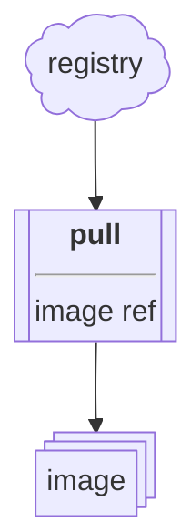
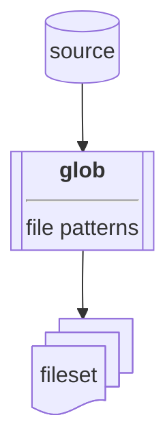
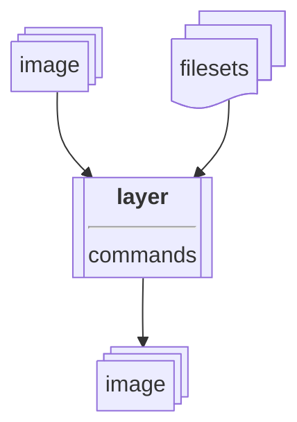
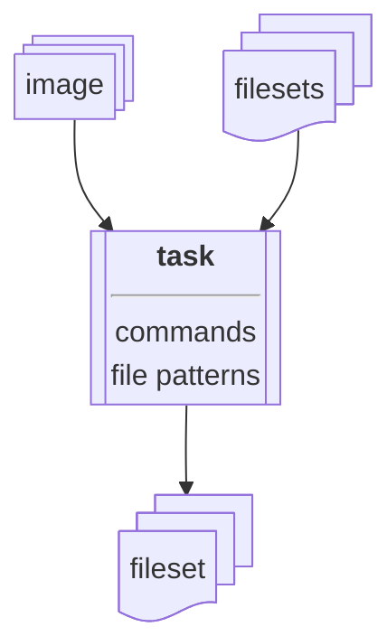
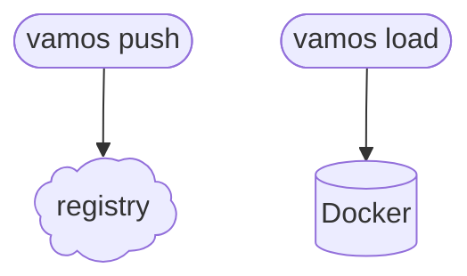
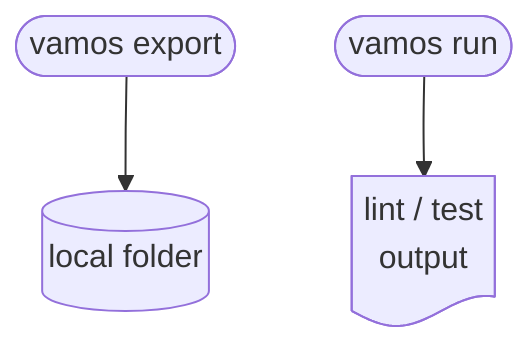
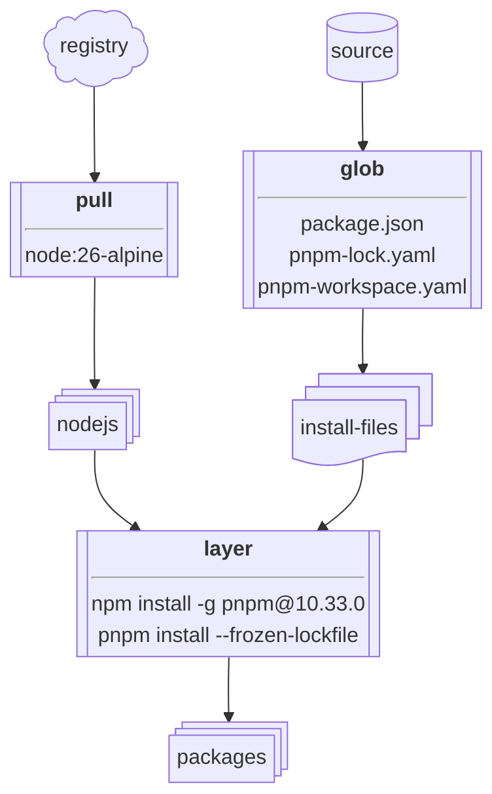
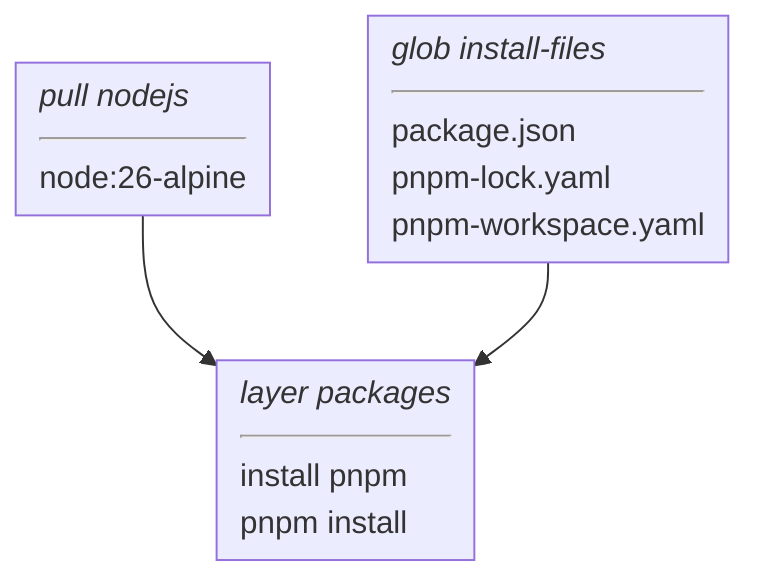
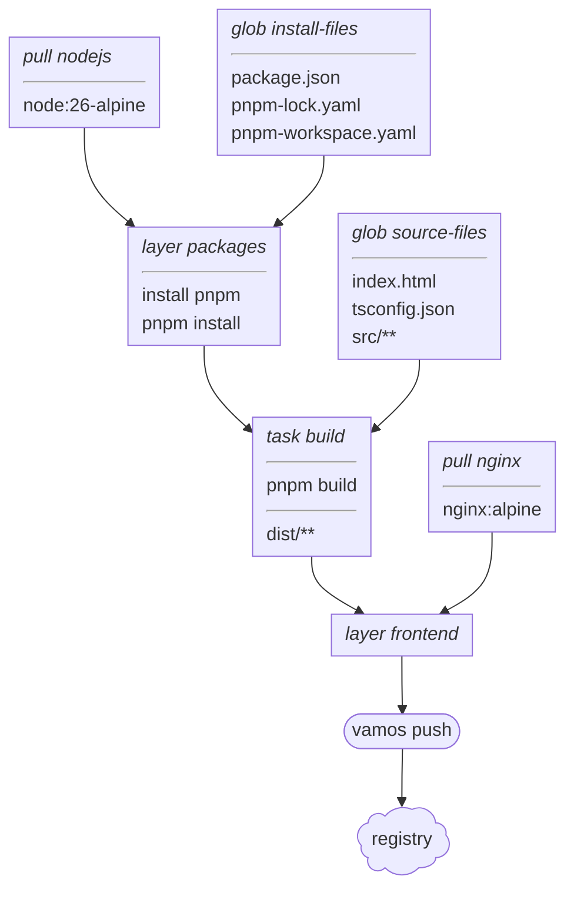

Vamos manipulates two kinds of artifacts:

- An **image** is a standard OCI container image.
  An image can provide build tools for a later build step, or it can run the finished application.
- A **fileset** contains files at relative paths, like a tarball or zip archive.
  They can be copied into an image, or they can be written out locally.

Vamos provides two operations to act on these artifacts:

- A **layer** starts from a base image, adds filesets, runs commands, and preserves the new image.
- A **task** starts from a base image, adds filesets, runs commands, and collects selected files into a new fileset.

Two operations bring external inputs into a build:

- **`pull()`** fetches an image from a container registry.
- **`glob()`** selects local files into a fileset.

Delivery commands take results out of the build:

- `vamos push` and `vamos load` send images to a registry or Docker.
- `vamos export` writes a task's fileset into a local folder.
- `vamos run` (planned) shows a task's output in the terminal.

<table class="artifact-grid">
<thead>
<tr><th></th><th>Images</th><th>Filesets</th></tr>
</thead>
<tbody>
<tr>
<th>Input</th>
<td>



</td>
<td>



</td>
</tr>
<tr>
<th>Build</th>
<td>



</td>
<td>



</td>
</tr>
<tr>
<th>Output</th>
<td>



</td>
<td>



</td>
</tr>
</tbody>
</table>

## Example: Set up Node.js

For example, to set up Node.js and packages:

- Pull the Node.js image
- Add the package manifests for `pnpm`
- Run `pnpm install`



The diagrams are great for explaining, but of course we write text in the repo.
Each image and fileset artifact gets a name so that other targets can reference them.

```python
pull(
    name="nodejs",
    image="docker.io/library/node",
    tag="26-alpine",
)

glob(
    name="install-files",
    include=["package.json", "pnpm-lock.yaml", "pnpm-workspace.yaml"],
)

layer(
    name="packages",
    base="nodejs",
    steps=[
        workdir("/workspace"),
        add("install-files", "/workspace"),
        run(["npm", "install", "-g", "pnpm@10.33.0"]),
        run(["pnpm", "install", "--frozen-lockfile"]),
    ],
)
```

The diagrams so far have explicitly represented the intermediate artifacts,
but we can elide those without risking confusion,
so from now on we will draw diagrams that focus on the steps.



## Example: Build a JS UI

Building on the example above, we can build a TypeScript UI and install it into an nginx container:

- Pull Node.js
- Add install files and run pnpm install
- Add source files and run pnpm build
- Pull nginx
- Add the build output
- Push that to an image repository



You can find the complete BUILD file in
[examples/typescript-ui/BUILD](https://github.com/vamos-build/vamos/blob/main/examples/typescript-ui/BUILD).
If you are adventurous, you can jump straight into it. The rest of this page walks through it in detail.

## 1. Read the build inputs

Open [BUILD](https://github.com/vamos-build/vamos/blob/main/examples/typescript-ui/BUILD).
The first section declares the base image and source files:

```python
pull(
    name="nodejs",
    image="docker.io/library/node",
    tag="26-alpine",
)

glob(
    name="install-files",
    include=["package.json", "pnpm-lock.yaml", "pnpm-workspace.yaml"],
)

glob(
    name="source-files",
    include=["index.html", "tsconfig.json", "src/**"],
)
```

`pull()` specifies the image repository and tag as separate arguments.
`glob()` selects workspace files relative to the `BUILD` file.
The pattern `src/**` selects all files beneath `src/`.
Filesets preserve relative directory structure when added to container directories.

## 2. Install dependencies into an image

The `packages` layer installs build tools and project dependencies:

```python
layer(
    name="packages",
    base="nodejs",
    steps=[
        workdir("/workspace"),
        add("install-files", "/workspace"),
        run(["npm", "install", "-g", "pnpm@10.33.0"]),
        run(["pnpm", "install", "--frozen-lockfile"]),
    ],
)
```

Steps execute in order:

1. `workdir()` creates `/workspace` and sets it as the working directory for later steps and the resulting image.
2. `add()` copies the fileset from `install-files` into `/workspace`.
3. `run()` executes an argument list inside the container.
   It does not invoke an implicit shell and halts the build if the command exits with a non-zero status.

The resulting container image contains Node.js, pnpm, and installed dependencies under `node_modules`.

## 3. Build the website into a fileset

The `build` task compiles the application using the dependency image:

```python
task(
    name="build",
    base="packages",
    steps=[
        add("source-files", "/workspace"),
        run(["pnpm", "build"]),
    ],
    source="/workspace/dist",
    include=["."],
)
```

The task inherits `/workspace` as its working directory from the `packages` layer.
It adds the source files and executes `pnpm build`.
`source` designates the container directory to collect files from when execution completes.
`include = ["."]` collects the entire directory contents recursively.

The output artifact is a fileset containing `index.html` and bundled assets.
Paths are stored relative to `dist/`, excluding the `/workspace/dist` prefix
and all intermediate build tools.

## 4. Assemble and run the image

The final declarations pull nginx and assemble the runtime image:

```python
pull(
    name="nginx",
    image="docker.io/library/nginx",
    tag="alpine",
)

layer(
    name="frontend",
    base="nginx",
    steps=[add("build", "/usr/share/nginx/html")],
)
```

`add()` copies the compiled fileset from the `build` task into nginx's document root.
The layer inherits nginx's default startup command, so no explicit `command` step is needed.

## Try it yourself

[Install Vamos](install/README.md);
on a Docker host, [running it with Docker](install/docker.md) needs nothing else installed.
Then clone the repository and `cd` into the example, where the rest of these commands run:

```sh
git clone https://github.com/vamos-build/vamos.git
cd vamos/examples/typescript-ui
```

Build the `frontend` target and load its image into Docker:

```sh
vamos load frontend vamos-hello:dev
docker run --rm -d --name vamos-hello -p 8080:80 vamos-hello:dev
```

Open <http://localhost:8080> in your browser.
The page displays “Hello from vamos!” and “Built with Node.js, served by nginx.”

`vamos load` builds the target and any required dependencies before loading the image into Docker.
To build the target into the cache without sending the image to Docker, run `vamos build frontend`.

Edit the heading in `index.html` to read `Hello again!`, then rebuild:

```sh
vamos load frontend vamos-hello:dev
docker stop vamos-hello
docker run --rm -d --name vamos-hello -p 8080:80 vamos-hello:dev
```

Refresh your browser to see the updated page.
Because `index.html` changed, the `build` task and `frontend` layer ran again.
The inputs to `packages` did not change, so Vamos reused the cached `packages` layer without reinstalling dependencies.
If you rerun `vamos load` without changing files, all targets are reused from the build cache.

You can also extract the compiled website files directly to your host filesystem:

```sh
vamos export build out
```

The directory `out/` now contains the task's generated files.
To overwrite an existing directory, pass `vamos export build out --replace`.
Because `export` replaces the destination directory, always specify a dedicated folder for generated outputs.

When you are finished, stop the container and revert your change:

```sh
docker stop vamos-hello
git restore index.html
```

## Where to go next

Explore the reference manuals as your project requirements expand:

- [BUILD language](reference/build/README.md): target declarations, build steps, secrets, file filters, and check tasks.
- [CLI](reference/cli/README.md): publishing images to registries, multi-tag releases,
  saving tarball archives, and cache maintenance.
- [Configuration](reference/configuration.md): workspaces, target parameters,
  multi-platform builds, and shared `.star` files.
- [Build cache and traces](reference/cache.md): cache keys, rebuild policies, pinning pulls,
  and inspecting build performance with Perfetto traces.
- [Remote execution](reference/remote.md): distributing builds across a coordinator and worker pool on a shared network.

See the [examples directory](https://github.com/vamos-build/vamos/blob/main/examples/README.md)
for complete projects using Go, TypeScript, and monorepos.
