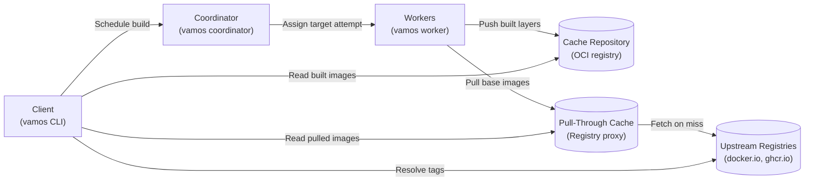

vamos supports distributed builds across a cluster of worker machines managed by a central coordinator.
A team can share a single build cache and worker pool:
targets already built by any team member are reused immediately,
independent targets run concurrently on separate workers,
and multi-platform images build natively on hardware matching each target architecture.

This reference explains the remote execution architecture, network requirements, worker scheduling,
operational controls, and deployment options.

## Architecture overview

Remote execution involves five cooperating components:

- **Client**: The developer workstation or CI runner executing `vamos` with `--coordinator <URL>`
  (or `$VAMOS_COORDINATOR`).
  The client uploads local workspace source files to the coordinator and streams build progress.
- **Coordinator**: The scheduling server (`vamos coordinator`).
  It tracks registered workers, schedules targets according to platform requirements,
  deduplicates concurrent requests for identical targets, and manages build state.
- **Workers**: Worker daemons (`vamos worker`) running on build machines.
  Workers execute build steps assigned by the coordinator inside isolated cgroups and chroot environments,
  then push intermediate layer images to the cache repository.
- **Cache repository**: An OCI container registry repository where workers push built layers tagged by image ID.
  Any worker or client can download cached layers by image ID.
- **Pull-through cache**: A local container registry proxy.
  Workers pull external base images through this proxy, reducing external registry traffic and avoiding rate limits.

This diagram shows how clients, the coordinator, workers, and registries interact during remote builds.



## Network and security

### Trusted network

The coordinator protocol does not authenticate clients or workers.
Anyone with network access to the coordinator can schedule builds, read cached targets, and access logs.
Deploy the coordinator exclusively on private, trusted networks behind a firewall or VPN.

### Registry access and credentials

Credentials and network access are partitioned by role:

- **Workers** use their own registry credentials to push intermediate layers to `--cache-repository`,
  pull base images from pull-through caches, and run `push` and `publish` by default.
  Client credentials are never transmitted to workers.
- **Clients** use their own local credentials to resolve upstream tags (during `vamos update` and pin recording),
  pull images during `load` and `save`,
  and push images when `--push-from=client` is specified.
- **Coordinator** credentials require read and delete permissions on the cache repository
  to delete cached layer tags during `vamos prune`.
- `vamos update` and pin recording resolve tags directly from the client against the upstream registry,
  bypassing pull-through caches to prevent reading stale tag mappings.

For registries that use plain HTTP, mark them as `insecure = true` in `/etc/containers/registries.conf`
on the coordinator and workers.
Clients automatically inherit the coordinator's `insecure = true` settings for the cache and pull-through registries;
for other plain-HTTP registries, configure the client's `registries.conf` or pass `--tls-verify=false`.

### Secrets

The `--secret` flag cannot be used with `--coordinator`
because secret values are not transmitted over unauthenticated network connections.
Build targets requiring secrets using local execution.

## Worker scheduling and platforms

### Platform routing

Workers register their native platform architecture (such as `linux/amd64` or `linux/arm64`) with the coordinator.
The coordinator assigns each target to a worker matching its base image's platform:
- A cluster with both `linux/amd64` and `linux/arm64` workers builds multi-platform image indexes natively,
  executing each platform's build steps on native hardware.
- Pulls and targets that only add files without running commands run on any available worker
  if a native worker is not registered.

### Offered platforms and emulation

The coordinator offers the platforms of all currently registered workers,
plus any platforms declared with `--offer <os/arch>`.
Use `--offer` so builds wait for a worker when all workers for that architecture are temporarily offline.
Targets that run commands on an unoffered platform fail unless emulation is enabled.

When a target's platform is not offered natively, its commands can run under QEMU emulation
on a worker that has a registered `binfmt_misc` emulator for that architecture.
Pass `--emulate` on the client to permit emulated execution on remote workers.
Use `--offer-emulated <os/arch>` on the coordinator
so emulated builds wait when no worker with that emulator is currently online.

### Default execution platform

Setting `--default-exec-platform <os/arch>` on the coordinator (along with `--offer <os/arch>`)
configures `EXEC_PLATFORM` consistently across all connected clients;
see [execution platform selection](configuration.md#execution-platform-selection).
This ensures clients running on different architectures (such as Apple Silicon laptops and x86 CI runners)
generate identical cache keys and reuse each other's native compilation tasks.

## Operational lifecycle

### Disconnections and grace periods

If a client's network connection drops during a build,
the coordinator preserves running and cached targets for the duration of `--grace` (default 5m).
When the client reconnects, it resumes watching build progress.
If the grace period expires before the client reconnects,
currently running targets finish and cache their results, while subsequent targets are halted.

The `--window` flag (defaulting to `--grace`) sets how long completed build results remain queryable
after completion or after the client disconnects.

### Worker leases and failure recovery

Workers send periodic heartbeats to maintain a lease on assigned target attempts (`--lease`, default 30s).
If a worker crashes or loses network connectivity, its lease expires.
The coordinator reassigns the failed work to another worker, up to `--retries` times (default 2).
Push operations and publication tagging are never retried automatically,
because partial writes may have already occurred.

### Coordinator state and restarts

The coordinator stores build cache data and job state in `--cache-dir`.
If the coordinator restarts with persistent storage, clients reconnect and resume their builds:
completed targets are restored from the cache, while in-progress targets restart on available workers.
Running coordinators acquire an exclusive lock on `--cache-dir`;
two coordinators cannot share the same state directory.

### Remote cache pruning

Run `vamos prune --coordinator <URL>` to prune the remote cache:
- Removes coordinator build records and uploaded workspace files.
- Deletes all cached layer tags from the cache repository (dedicate this repository to the vamos cache).
- Preserves recorded tag resolutions and cached upstream layers in the pull-through cache.

The cache repository registry must have deletion enabled.
Storage space in the registry is reclaimed when the registry's garbage collection runs.

## Deployment

### Docker Compose

The `remote/compose.yaml` file runs a local cluster for development and evaluation:
- A coordinator (`coordinator:8080`) offering `${VAMOS_PLATFORM:-linux/amd64}`.
- Two local workers (scale with `--scale worker=3`).
- A local registry (`registry:5000`) serving as the cache repository.
- A Docker Hub pull-through cache (`hub-proxy:5000`).

To start the cluster:

```sh
docker compose -f remote/compose.yaml up -d --build --wait
```

Because the Compose file does not publish host ports, connect your client container
to the `remote_default` network to reach the services by name:

```sh
docker network connect remote_default <client-container>
vamos build //:app --coordinator http://coordinator:8080
```

### Kubernetes Helm chart

The `remote/helm/vamos` directory provides a Helm chart for Kubernetes clusters.
The chart deploys:
- A coordinator StatefulSet and Service with persistent volume storage for `--cache-dir`.
- Worker Deployments across node pools of differing CPU architectures,
  configuring a private cgroup namespace for each worker container.
- Optional StatefulSets and Services for the cache registry and Docker Hub pull-through cache
  (which can be disabled when using existing registries).
- A shared ConfigMap for registry settings.

Configuration settings are documented in `remote/helm/vamos/values.yaml`.

## Coordinator and worker options

See [`vamos coordinator`](cli/coordinator.md) and [`vamos worker`](cli/worker.md) for each command's flags.

## Worker requirements

Worker daemons have specific host and container requirements:
- **Root privileges**: Workers must run as root to manage container namespaces and filesystem layers.
- **cgroup v2 and namespaces**: Workers manage target processes within cgroup hierarchies under `/sys/fs/cgroup/vamos`.
  Workers require a private cgroup namespace (standard in Docker; configured in Kubernetes via the Helm chart).
- **chroot isolation**: Workers execute steps using Buildah chroot isolation (`BUILDAH_ISOLATION=chroot`).
- **Container store**: Workers need dedicated container storage at `/var/lib/containers`.
- **Network egress**: Workers require network access to the coordinator, the cache repository,
  pull-through caches, and external networks required by `run()` steps.
