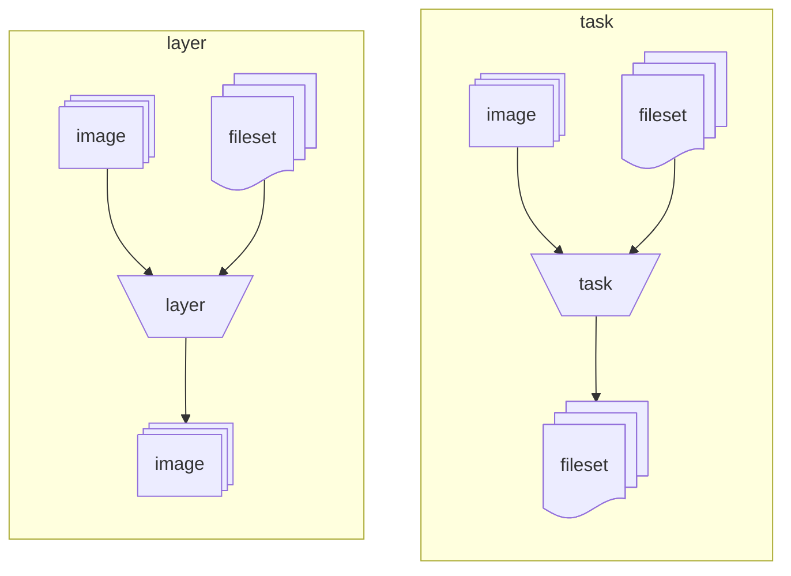
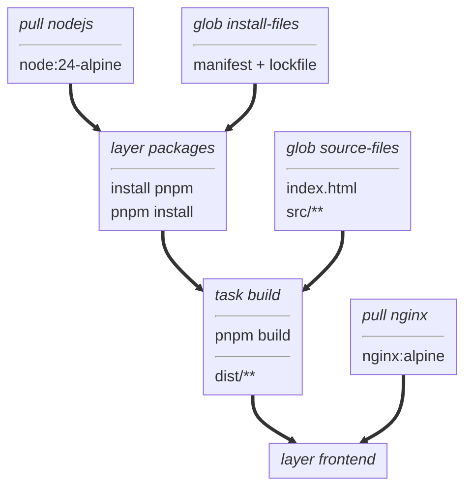

This tutorial walks through [examples/typescript-ui](https://github.com/vamos-build/vamos/tree/main/examples/typescript-ui),
a small TypeScript website built with Node.js and served by nginx.
You will learn the artifact model, set up vamos, and read the example's `BUILD` file one target at a time.
All the project files are included in the repository.

The finished image contains only nginx and the compiled website;
Node.js and intermediate build dependencies stay in the build cache.
You need a checkout of this repository, Docker, and network access to fetch images and packages.
Node.js and pnpm run inside build containers, so you do not need to install them on your host.

## 1. Understand what a build produces

vamos operations manipulate two kinds of artifacts:

- An **image** is a standard OCI container image.
  An image can provide build tools or run the finished application.
- A **fileset** contains files at relative paths, including their permission modes and symbolic links.
  Think of it as the contents of an uncompressed archive.
  Adding a fileset containing `assets/main.js` to `/app` creates `/app/assets/main.js`.

Two operations turn these artifacts into new results:

- A **layer** starts from a base image, adds filesets, runs commands, and preserves the new image.
  It retains its base image's files and configuration, plus its own changes.
- A **task** starts from a base image, adds filesets, runs commands,
  and collects selected files into a new fileset.
  Its temporary container is discarded after collection,
  so only the selected files pass to subsequent targets.

This diagram shows the inputs and outputs of layers and tasks:
layers produce container images, while tasks produce filesets.



Both operations can add input filesets and run commands inside their base image.
For this website, a layer installs dependencies into a Node.js image.
A task uses that dependency image to build the website and collects only the generated files.
A final layer adds those files to an nginx runtime image.
That separation keeps build tools out of the application image.

Two operations bring external inputs into a build:
- **`pull()`** fetches an image from a container registry.
- **`glob()`** selects local files into a fileset.

A `BUILD` file declares these operations as named targets in Starlark, a Python-like language.
Targets refer to one another by name: `base` selects an image, and `add()` copies in a fileset.
Declare local targets before the targets that use them.
Because a task produces a fileset, it cannot serve as another target's base image.

## 2. Set up vamos

vamos uses Buildah and requires Linux container privileges.
Choose one of the first two setups to complete the tutorial.
The third setup installs vamos in your own project's devcontainer.

### In the repository's devcontainer

Open the repository with its [devcontainer configuration](https://github.com/vamos-build/vamos/blob/main/.devcontainer/devcontainer.json).
It provides the build dependencies, privileges, chroot isolation, and container storage vamos needs.
From the repository root:

```sh
go build -o /tmp/vamos .
export PATH="/tmp:$PATH"
vamos --help
```

### With Docker

From the repository root, build the CLI image:

```sh
docker build -t vamos .
```

On the Docker host, define this shell function:

```sh
vamos() {
    docker run --rm --privileged \
        -v vamos-cache:/var/lib/containers \
        -v /var/run/docker.sock:/var/run/docker.sock \
        -v "$PWD:/project" \
        -w /project \
        vamos "$@"
}
```

This assumes a Docker daemon at `/var/run/docker.sock` and a host directory Docker can mount.
The named volume preserves the build cache between invocations.
Run the function from your project directory; paths passed to vamos refer to the container filesystem.
If you are already inside a devcontainer, use the first setup because container paths differ from host paths.

### In your project's devcontainer

To build your own projects, install vamos in the container image your devcontainer runs.
Each [release](https://github.com/vamos-build/vamos/releases) publishes an `install.sh` script.
The script downloads the binary for the host platform (`linux/amd64` or `linux/arm64`),
verifies it against `SHA256SUMS`, and installs it as `/usr/local/bin/vamos`.
The binary requires glibc 2.34 or later.

Add these lines to an Ubuntu 24.04 Dockerfile:

```dockerfile
FROM ubuntu:24.04

RUN apt-get update \
 && apt-get install -y --no-install-recommends \
      ca-certificates \
      curl \
      golang-github-containers-common \
      netavark \
 && rm -rf /var/lib/apt/lists/*

RUN curl -fsSL -o /tmp/vamos-install.sh https://github.com/vamos-build/vamos/releases/download/v0.1.0/install.sh \
 && sh /tmp/vamos-install.sh \
 && rm /tmp/vamos-install.sh

# Run build steps with chroot isolation, so no OCI runtime is needed.
ENV BUILDAH_ISOLATION=chroot
```

Combine the package installation with your existing `apt-get install` step.
`install.sh` requires `curl` (or `wget`) and `ca-certificates` to download the release binary.
It does not install packages itself:
it checks for required packages and prints the `apt-get` or `dnf` command to install any that are missing.
If packages are missing, the script installs the binary and exits with status 1,
stopping Docker builds before the image is finished.
Pass `--allow-missing` or set `VAMOS_ALLOW_MISSING=1` to skip this check.
On Fedora, install `ca-certificates`, `containers-common`, and `netavark`.

To install vamos directly on a Linux host, run:

```sh
curl -fsSL https://github.com/vamos-build/vamos/releases/latest/download/install.sh | sh
```

The [published image](https://github.com/vamos-build/vamos/pkgs/container/vamos) has the same binary,
at `/usr/local/bin/vamos`, if you prefer to `COPY --from=ghcr.io/vamos-build/vamos:0.1.0` it.

In `.devcontainer/devcontainer.json`, run the container privileged,
mount a dedicated volume for container storage,
and mount the Docker socket if you use `vamos load`:

```json
"runArgs": ["--privileged"],
"mounts": [
  "source=vamos-storage,target=/var/lib/containers,type=volume",
  "source=/var/run/docker.sock,target=/var/run/docker.sock,type=bind"
]
```

The named volume retains the build cache when the devcontainer is rebuilt.
Run vamos as root, or with `sudo` if your devcontainer user is non-root.

To build images for other architectures, register QEMU emulators on the Docker host.
Docker Desktop registers emulators automatically.
On Linux hosts, register emulators after booting:

```sh
docker run --privileged --rm tonistiigi/binfmt --install all
```

Each environment requirement corresponds to a specific failure symptom:

| Requirement | Purpose | Error without it |
| --- | --- | --- |
| `ca-certificates` | Trust certificate authorities for registry TLS | `x509: certificate signed by unknown authority` |
| `golang-github-containers-common` | Provide `/etc/containers/policy.json` and `registries.conf` | `no policy.json file found` |
| `netavark` | Configure network interfaces for `run` steps | `could not find "netavark"` |
| `BUILDAH_ISOLATION=chroot` | Execute build steps without an OCI runtime daemon | `did not get container create message from subprocess` |
| Volume for `/var/lib/containers` | Provide overlay storage compatible with nested containers | `Failed to built-in GetDriver graph btrfs`, followed by slow `vfs` storage |
| Emulators on Docker host | Execute steps for foreign architectures | `exec format error` |

## 3. Open the example

From the repository root, change into the example directory:

```sh
cd examples/typescript-ui
```

Run all subsequent tutorial commands from this directory.
The project is complete and ready to build:

```text
typescript-ui/
├── BUILD
├── package.json
├── pnpm-lock.yaml
├── pnpm-workspace.yaml
├── tsconfig.json
├── index.html
└── src/
    └── main.ts
```

[index.html](https://github.com/vamos-build/vamos/blob/main/examples/typescript-ui/index.html)
defines a heading and an empty message paragraph, then loads `src/main.ts`.
[src/main.ts](https://github.com/vamos-build/vamos/blob/main/examples/typescript-ui/src/main.ts)
populates that paragraph:

```typescript
const message = document.querySelector<HTMLParagraphElement>("#message");
if (message) {
  message.textContent = "Built with Node.js, served by nginx.";
}
```

[package.json](https://github.com/vamos-build/vamos/blob/main/examples/typescript-ui/package.json)
defines the `pnpm build` script.
It runs the TypeScript compiler to verify types, then bundles static assets into `dist/` with Vite.
The targets in `BUILD` run those commands inside container steps.

## 4. Plan the build

This diagram shows the target dependency graph for the TypeScript UI example,
connecting input images and source files to the final frontend image.



Two separate dependency chains lead into the final `frontend` layer:
1. Node.js, dependency manifests, and source files feed the `build` task.
2. The `nginx` pull provides the runtime web server image.

The `packages` layer installs dependencies separately from website source files.
Editing HTML or TypeScript invalidates only the `build` task, avoiding repeated dependency installations.

## 5. Read the build inputs

Open [BUILD](https://github.com/vamos-build/vamos/blob/main/examples/typescript-ui/BUILD).
The first section declares the base image and source files:

```python
pull(
    name = "nodejs",
    image = "docker.io/library/node",
    tag = "24-alpine",
)

glob(
    name = "install-files",
    include = ["package.json", "pnpm-lock.yaml", "pnpm-workspace.yaml"],
)

glob(
    name = "source-files",
    include = ["index.html", "tsconfig.json", "src/**"],
)
```

`pull()` specifies the image repository and tag as separate arguments.
`glob()` selects workspace files relative to the `BUILD` file.
The pattern `src/**` selects all files beneath `src/`.
Filesets preserve relative directory structure when added to container directories.

## 6. Install dependencies into an image

The `packages` layer installs build tools and project dependencies:

```python
layer(
    name = "packages",
    base = "nodejs",
    steps = [
        workdir("/workspace"),
        add("install-files", "/workspace"),
        run(["npm", "install", "-g", "pnpm@10.33.0"]),
        run(["pnpm", "install", "--frozen-lockfile"]),
    ],
)
```

Steps execute in order:
1. `workdir()` creates `/workspace` and sets it as the working directory for later steps and the resulting image.
2. `add()` copies the fileset from `install-files` into `/workspace`.
3. `run()` executes an argument list inside the container.
   It does not invoke an implicit shell and halts the build if the command exits with a non-zero status.

The resulting container image contains Node.js, pnpm, and installed dependencies under `node_modules`.

## 7. Build the website into a fileset

The `build` task compiles the application using the dependency image:

```python
task(
    name = "build",
    base = "packages",
    steps = [
        add("source-files", "/workspace"),
        run(["pnpm", "build"]),
    ],
    source = "/workspace/dist",
    include = ["."],
)
```

The task inherits `/workspace` as its working directory from the `packages` layer.
It adds the source files and executes `pnpm build`.
`source` designates the container directory to collect files from when execution completes.
`include = ["."]` collects the entire directory contents recursively.

The output artifact is a fileset containing `index.html` and bundled assets.
Paths are stored relative to `dist/`, excluding the `/workspace/dist` prefix
and all intermediate build tools.

## 8. Assemble and run the image

The final declarations pull nginx and assemble the runtime image:

```python
pull(
    name = "nginx",
    image = "docker.io/library/nginx",
    tag = "alpine",
)

layer(
    name = "frontend",
    base = "nginx",
    steps = [add("build", "/usr/share/nginx/html")],
)
```

`add()` copies the compiled fileset from the `build` task into nginx's document root.
The layer inherits nginx's default startup command, so no explicit `command` step is needed.

Build the `frontend` target and load its image into Docker:

```sh
vamos load frontend vamos-hello:dev
docker run --rm -d --name vamos-hello -p 8080:80 vamos-hello:dev
```

Open <http://localhost:8080> in your browser.
The page displays “Hello from vamos!” and “Built with Node.js, served by nginx.”

`vamos load` builds the target and any required dependencies before loading the image into Docker.
To build the target into the cache without sending the image to Docker, run `vamos build frontend`.

## 9. Make a change and reuse the build

Edit the heading in `index.html` to read `Hello again!`, then rebuild:

```sh
vamos load frontend vamos-hello:dev
docker stop vamos-hello
docker run --rm -d --name vamos-hello -p 8080:80 vamos-hello:dev
```

Refresh your browser to see the updated page.
Because `index.html` changed, the `build` task and `frontend` layer ran again.
The inputs to `packages` did not change, so vamos reused the cached `packages` layer without reinstalling dependencies.
If you rerun `vamos load` without changing files, all targets are reused from the build cache.

You can also extract the compiled website files directly to your host filesystem:

```sh
vamos export build out
```

The directory `out/` now contains the task's generated files.
To overwrite an existing directory, pass `vamos export build out --replace`.
Because `export` replaces the destination directory, always specify a dedicated folder for generated outputs.

When you are finished, stop the container and revert your change:

```sh
docker stop vamos-hello
git restore index.html
```

## Where to go next

Explore the reference manuals as your project requirements expand:

- [BUILD language](reference/build/README.md): target declarations, build steps, secrets, file filters, and check tasks.
- [CLI](reference/cli/README.md): publishing images to registries, multi-tag releases,
  saving tarball archives, and cache maintenance.
- [Configuration](reference/configuration.md): workspaces, target parameters,
  multi-platform builds, and shared `.star` files.
- [Build cache and traces](reference/cache.md): cache keys, rebuild policies, pinning pulls,
  and inspecting build performance with Perfetto traces.
- [Remote execution](reference/remote.md): distributing builds across a coordinator and worker pool on a shared network.

See the [examples directory](https://github.com/vamos-build/vamos/blob/main/examples/README.md)
for complete projects using Go, TypeScript, and monorepos.
